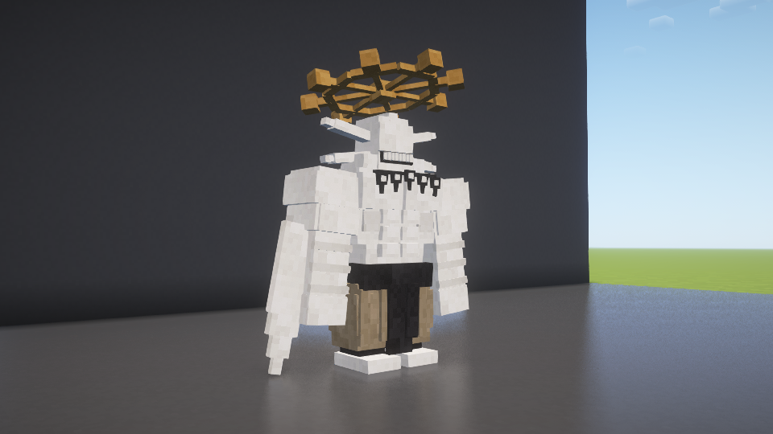
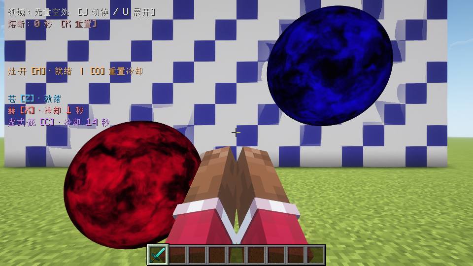
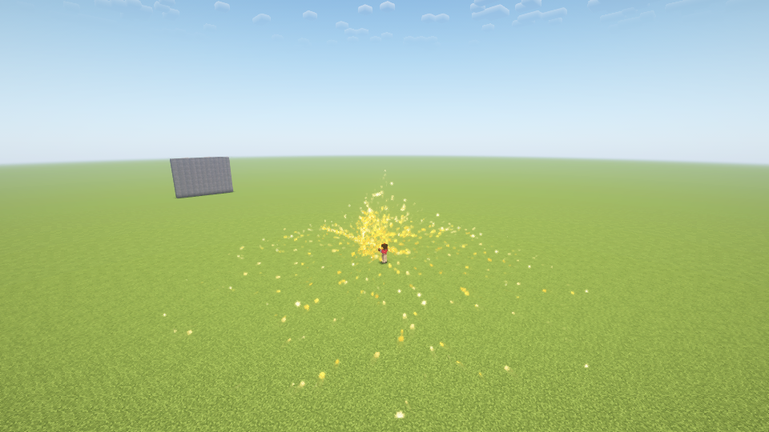
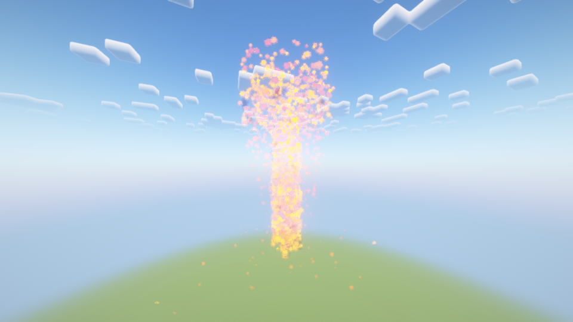
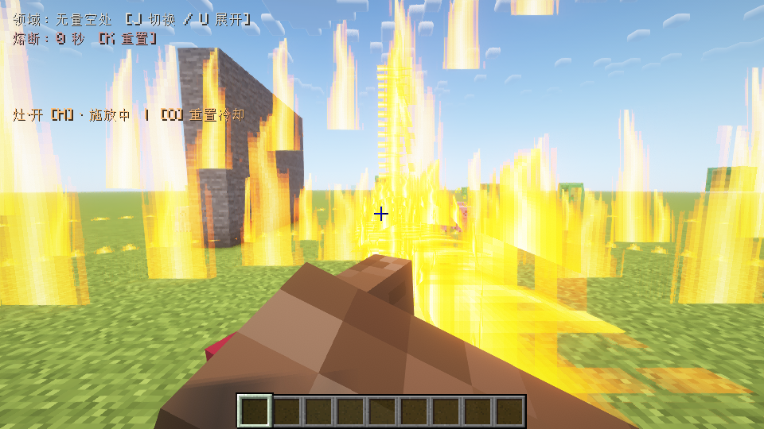
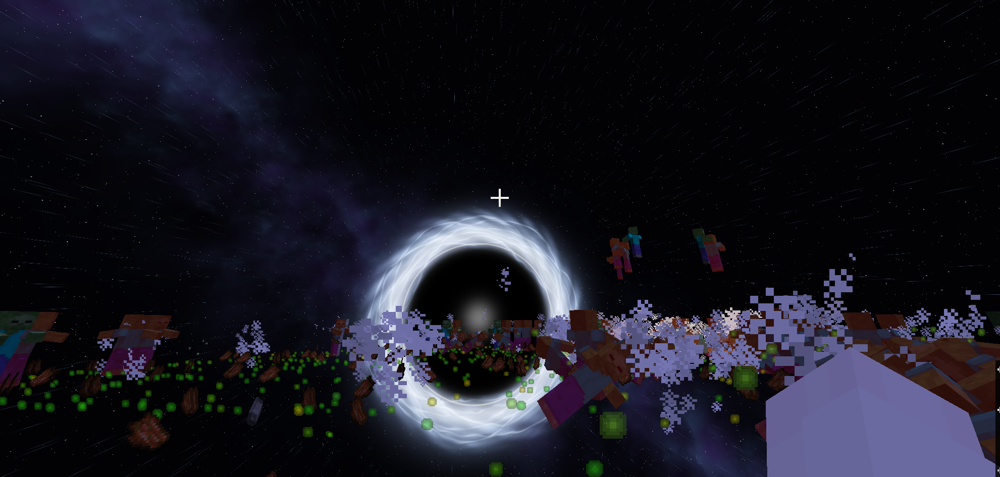
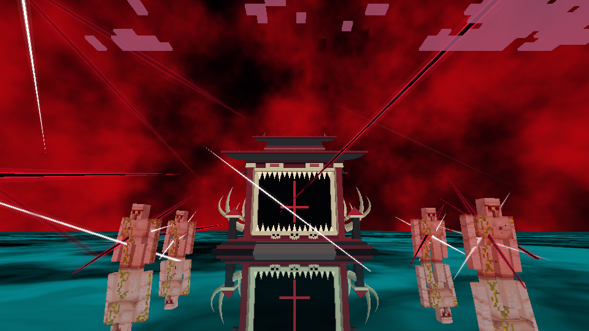

# 咒术领域 · Jujutsu Domains

> 当前本地版本：**1.10.2**（GitHub正式版1.10.0）（魔虚罗、逐步适应与宿傩战斗修复）。灶·开现已默认使用粒子火焰、火矢拖尾和爆燃烟尘。向空中的苍射入赫，或向赫射入苍，形成逐渐膨胀并大范围爆炸的自爆茈。

[](https://github.com/Zeek114514/jujutsu-domains-forge/actions/workflows/build.yml)
[](https://www.minecraft.net/)
[](https://files.minecraftforge.net/net/minecraftforge/forge/index_1.20.1.html)
[](https://github.com/Zeek114514/jujutsu-domains-forge/releases/latest)

**Zeek114514 的个人 Minecraft Java 模组作品。** 基于 Forge 1.20.1，实现《咒术回战》风格的无量空处、伏魔御厨子、领域对峙，以及灶·开火矢演出。

无量空处以纯白空间与宇宙结界封锁战场，御厨子以升起的神龛、镜面地面和开放式斩击覆盖周围。新增灶·开从聚火、拉弓到爆燃展开，提供独立的台词、射出声与命中余响。灶·开现已接入服务端范围伤害及御厨子粉尘引爆；地形破坏仍默认关闭。

[1.4.0画面与验证](docs/LIMITLESS_ORBS_VALIDATION.md) · [音频来源](requested_limitless/README.md) · [苍、赫、茈指南](docs/LIMITLESS.md) · [1.3.0验证](docs/LIMITLESS_VALIDATION.md) · [1.2.1手势记录](docs/VANILLA_SEALS_VALIDATION.md) · [灶·开指南](docs/FUGA.md) · [开发进度](docs/PROGRESS.md) · [1.1.0验证记录](docs/FUGA_COMBAT_VALIDATION.md) · [Wiki](https://github.com/Zeek114514/jujutsu-domains-forge/wiki)

## 下载和安装

1. 安装 **Minecraft Java 1.20.1、Forge 47.4.10 或更高的 47.x、Java 17**。
2. 前往 [Releases](https://github.com/Zeek114514/jujutsu-domains-forge/releases/latest)，下载 `unlimited-void-1.20.1-1.10.0.jar`。
3. 放进当前游戏实例的 `mods` 文件夹。升级时移走旧版同名模组，避免重复加载，随后重启游戏。
4. 多人游戏中客户端与服务端都要安装相同版本。

升级时同时更新客户端和服务端；本版网络协议与旧预览版不同。

开发依赖为Forge47.4.10，1.10.0实机使用Forge47.4.20。当前新增内容验证见[魔虚罗记录](docs/MAHORAGA_VALIDATION.md)和[宿傩平衡记录](docs/NPC_BALANCE_VALIDATION.md)；既有内容见[灶·开粒子记录](docs/FUGA_PARTICLES_VALIDATION.md)，自爆茈沿用[1.5.0记录](docs/PURPLE_DETONATION_VALIDATION.md)。此前记录按各自版本保留，不表示所有47.x、光影组合和硬件均已覆盖。御厨子血红天空/镜面的指定光影限制仍见[1.4.1记录](docs/SHRINE_SLASH_VALIDATION.md)。

## 角色与战斗（1.10.2）

六种NPC使用用户提供的玩家皮肤。五条主要快速接近怪物近战；高专只用苍拳，觉醒/新宿使用苍拳和赫拳，分别短促吸近或击退。常规远程术式至少间隔8秒，进阶远程分支茈仍为5%。新宿遇原身宿傩优先贴近放茈。高专首次濒死以默认50%概率满血觉醒并立即放茈；觉醒/新宿低于5%触发一次自爆茈。

生命值：高专400、觉醒800、新宿1000、虎皮宿傩800、惠皮宿傩900、原身宿傩1000。除高专外均有反转术式：伤后等3秒，每2秒回复0.5%最大生命。空手右键查看血量。旧NPC按原血量比例升级。

1.9.1修复宿傩近身延展突破无限、无量空处内行动、御厨子从结界外侧破壳及下神龛追击，并按“高专 < 觉醒 < 虎皮 < 新宿五条≈惠皮 ≤ 原身”调整当前形态输出、承伤和速度。

所有五条可低概率无量空处，三种宿傩可普攻、解/捌、低概率伏魔御厨子与极低概率粒子灶·开。双方开始开领域时立即反开，同类NPC同维度只维持一个领域。虎皮交付手指→新宿（惠皮），新宿濒死以默认50%概率→原身并满血。惠皮宿傩现在可低概率从影池召唤魔虚罗：巨型立体模型、八握轮盘、逐步适应、近战与适应无下限后的空间斩。详见[魔虚罗指南](docs/MAHORAGA.md)。

独立【咒术领域】创造栏包含七种生成蛋、眼罩和手指，共九个物品。原有物品变身路线保留。NPC不主动伤害玩家和普通友方生物，术式不破坏地形。



魔虚罗每完成一级适应增加5%体型，无预设上限；身体、碰撞和近战触及距离同步成长。濒死变身每个角色一生只判定一次，失败会保存，不反复重抽。

配置、濒死优先级和原版玩家形态说明见[NPC指南](docs/NPCS.md)。客户端/服务端都需更新1.10.2（无下限通道协议7，领域协议14）。

## 玩法

| 按键 | 功能 |
| --- | --- |
| `U` | 展开当前领域，再按一次主动解除 |
| `J` | 切换无量空处 / 伏魔御厨子 |
| `K` | 重置领域熔断与苍、赫、茈的冷却 |
| `H` | 灶·开：聚火、满蓄力、吟唱后射出火矢 |
| `O` | 重置灶·开的独立冷却，不打断当前施放 |
| `Z` | 苍：按住蓄力，松开发射，持续吸引附近目标 |
| `X` | 赫：发射红色斥力球并击飞目标 |
| `C` | 虚式·茈：苍赫融合后向前发射 |

领域咏唱时自动摆出手势：五条单手抬到脸前，宿傩双手向中间靠拢，均使用原版方块手臂。第一、第三人称均可见；咏唱结束或领域解除后恢复原持物。

按键可在游戏设置中修改。两种领域共用 40 秒熔断；完全成型后持续约 20 秒，解除时有约 2 秒过渡。

### 苍、赫与虚式·茈

苍提供持续引力和伤害，赫提供爆发与击退，茈先将苍赫汇合，再以紫色能量球贯穿路径上的生物。三种术式分别冷却，使用原版方块手臂、光效和分阶段的出招语音、招式音效。默认保留地形，完整机制见[术式指南](docs/LIMITLESS.md)。

单独的苍采用白色亮核与青蓝火焰，赫采用紧凑红球、亮核与火花；只有合成茈时的苍赫使用深蓝、暗红云纹球。茈成型后显示紫色球壳、内部星点、白粉亮核与跳动闪电，球体周围会折射背景。

**空中自爆茈**：先向空中射出苍或赫，瞄准停留的能量球再射出相反属性，两种顺序都支持。融合后约2.2秒膨胀并爆炸，默认半径64格、中心480点基础伤害，施术者承受5%反噬。地形破坏默认关闭；玩法和配置见[术式指南](docs/LIMITLESS.md)。



### 灶·开 · Fūga

- 约 1.5 秒达到最大蓄力，在「Fuga」台词期间保持，约 2.7 秒射出；独立冷却 10 秒。
- 独立粒子组成聚火、火弓、火矢拖尾、上升火团、火星和烟尘，默认启用，无需额外启动参数。
- 火矢射程最多 64 格；命中后地面火焰向外扩散，升起最高约 240 格的粒子火柱与烟尘，爆燃约 6.6 秒。
- 台词、射出破空声、命中爆燃声分别触发。音效定位在对应发射点和命中点，远近落点按实际飞行时间衔接。
- 左上角常驻显示按键与施放/冷却状态；取消施放、退出或切换世界时清理相关演出和音频。





*1.5.1独立测试世界实机截图：Forge47.4.20、Oculus1.8.0、Embeddium0.3.31、Complementary Reimagined5.2.2。可见范围受视距、雾和地形遮挡影响。每客户端最多4500个存活粒子、每tick新建300个；这不是全硬件性能保证。*

普通火矢默认伤害半径200格、中心240点生命值，边缘仍有60点；自己的御厨子粉尘满后可消耗并触发领域范围的强化爆燃，中心最大480点。每目标每次施放最多命中一次，支持队友、宠物、抗火和结界保护。



### 无量空处

- 半径 16 格的封闭球形结界，外部显示黑球。
- 纯白空间从后向前推进，再逐渐转为星空、星云与流动光环。
- 完整结界持续期间限制出入；被捕获的目标定身并持续受伤。施术者、队友和受保护宠物按服务端规则处理。
- 保留迭代确认的光环造型，位置在该版基础上上移 2.4 格。



*开发过程实机截图。展示领域氛围，正式版的位置以游戏内效果为准。*

### 伏魔御厨子

- 开放式领域，默认最大半径 200 格，允许目标自由进出。
- 咏唱中段神龛开始升起，台词结束时完成展开，天空转为血红并开始斩击。
- 神龛是带碰撞的临时实体，可站立和跳跃；结束后下沉移除，不在世界中放置永久建筑。
- 空中施术时，神龛从人物正下方最近的实体地面或屋顶升起。半砖和台阶按实际碰撞面定位；没有支撑面时取消展开。
- 屋脊达到人物脚底后托举；高于神龛最终高度的空中人物不会被突然拉下。
- 青黑色镜面地面带流动雾纹，可反射神龛及附近生物。
- 包含「解」「捌」、可配置咒力与外部结界破坏规则。地形破坏默认关闭。
- 解以白色尖刃和红黑裂痕高速掠过，捌在生物附近交叉闪现。两端收尖，短暂出现后淡出。[斩击画面与验证](docs/SHRINE_SLASH_VALIDATION.md)



### 对峙和演示指令

以下指令需要管理员权限或启用作弊：

```mcfunction
/domain clash
/domain spawn void
/domain spawn shrine
/domain clear
```

`/domain clash` 在两侧生成两个领域，方便观察一半宇宙、一半血色天空。成型后的重叠区采用同等精度的必中抵消规则；御厨子位于无量空处外部时可以持续攻击其结界。生成的演示领域用 `/domain clear` 解除。

```mcfunction
/domain energy @e[type=minecraft:zombie,distance=..20] 100
/domain terrain true
/domain terrain false
```

`/domain terrain true` 会启用真实、永久的地形破坏。默认关闭；仅在需要时手动开启。

## 配置

首次运行后生成 `config/unlimitedvoid-common.toml`。常用配置：

```toml
shrineRadius = 200
casterEnergy = 100.0
livingEntityEnergy = 100.0
shrineTerrainDamage = false
blocksDestroyedPerTick = 96
```

完整规则与兼容性限制见 [游戏说明](docs/GAMEPLAY.md)。

## 从源码构建

需要 **64 位 JDK 17**，项目已包含 Gradle Wrapper。首次构建需要联网下载依赖。

```powershell
# Windows PowerShell
.\gradlew.bat --no-daemon build
```

```sh
# Linux / macOS
./gradlew --no-daemon build
```

当前安装包在 `build/libs/unlimited-void-1.20.1-1.3.1.jar`。开发客户端使用 `./gradlew runClient`。自动构建运行时序、战斗/渲染预算和寻地共147项无窗口检查，不启动游戏。

仓库已经包含运行所需的音频资源，正常构建无需重新加工音频。可选的素材处理脚本位于 `tools/`，依赖 Python 3 与 FFmpeg，来源见 [第三方素材说明](THIRD_PARTY_NOTICES.md)。

## 验证与限制

v1.1.0通过本地构建、147项无窗口检查、双客户端本机TCP联网、光影实际启用、镜面状态恢复与96目标预算检查。第一人称双手、普通/粉尘伤害、远端时序与音效去重均已检查。完整范围及限制见 [1.1.0验证](docs/FUGA_COMBAT_VALIDATION.md)。

正式版 v1.0.0 的历史构建与基线比对记录保留在 [发布验证](docs/VALIDATION.md)。CI 通过不代表多人、光影或所有场景均已验收。

本项目没有独立领域维度。镜面只反射附近实体，不反射整片方块地形；镜面颜色覆盖不会抹平实际地形碰撞。神龛完整体积在复杂地形中的避障、低矮洞穴、其他光影模组、多人对抗与大量实体性能仍有兼容性限制。详见游戏说明。

## 作者与许可

项目作者 / 维护者：[Zeek114514](https://github.com/Zeek114514)。

项目代码以 [MIT](LICENSE) 开源。第三方角色台词、角色相关音效、Freesound 素材及其来源单独列于 [THIRD_PARTY_NOTICES.md](THIRD_PARTY_NOTICES.md)；它们不因为收录在本仓库而自动获得 MIT 许可，也不声明为作者原创。

本项目为非官方同人作品，与 Minecraft、Mojang、Microsoft 或《咒术回战》权利方不存在官方关联。

本轮完整记录：[NPC领域与宿傩验证](docs/NPC_DOMAINS_VALIDATION.md)。

[1.9.1宿傩与形态战力验证](docs/NPC_BALANCE_VALIDATION.md)。
