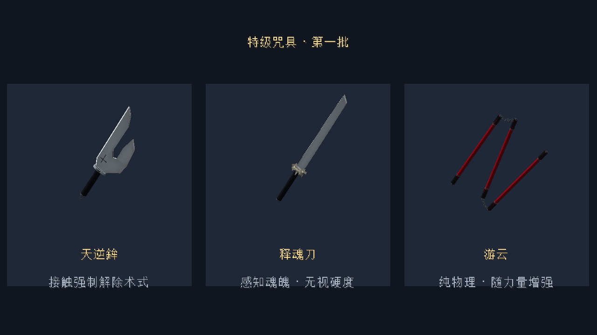
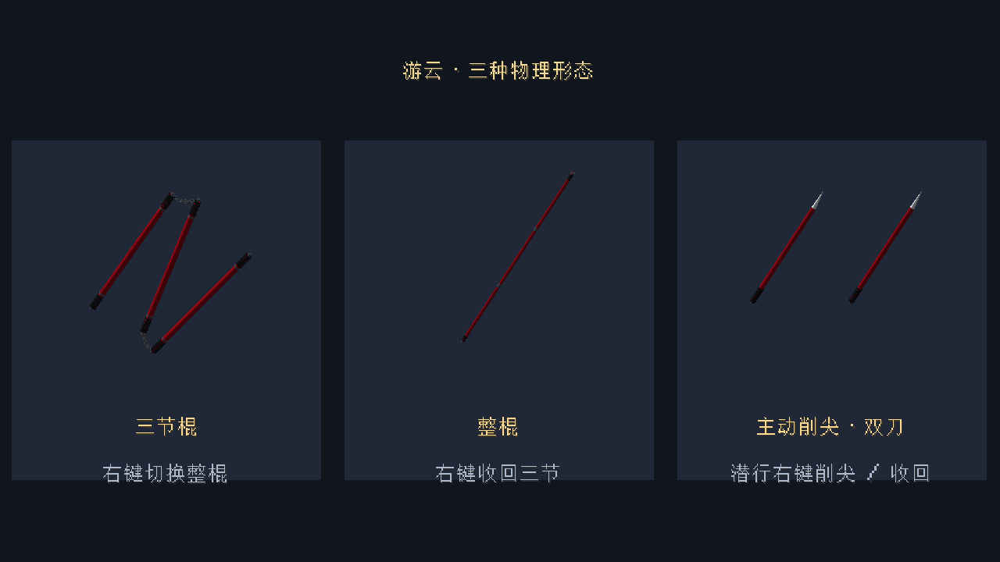

# 特级咒具：参考图重制

三件武器位于“咒术领域”创造栏，可正常附魔，保留下界合金级耐久和防火属性。通过创造栏或 `/give` 获取。物品ID不变，已有武器可直接随模组更新。

## 独立模型

根据用户提供的三张参考图重制为 OBJ/MTL 网格和专用原创材质，不再使用原版方块模型或铁块、羊毛、混凝土材质。

- 天逆鉾：不对称十手刀刃，长短刃之间留出开口；薄刃倒角与根部刻记；椭圆钢护手、加粗约46%的绕线刀柄和尾环。
- 释魂刀：长刀身、渐收刀尖、明亮刀锋、黑色绕柄；不规则毛束网格护手，不使用羊毛方块；刀柄加粗约50%、加长约40%。
- 游云：三根细长红漆圆棍，黑色端头、握纹、暗钢套环与交错镂空环链。图片中的展示架不属于武器。

生成脚本为 `tools/create_cursed_tool_assets.py` 和 `tools/create_cursed_tool_meshes.py`。基础网格分别1114、910、7008个面，材质为模组自己的 `textures/item/cursed_*`，无需额外模组或外部资源包。保留原版挥击动作并增加双刀副手显示；游云链节暂未进行独立物理模拟。

## 能力与操作

| 咒具 | 玩家基础总伤害 | 攻击速度 | 游戏内实现 |
| --- | --- | --- | --- |
| 天逆鉾 | 18 | 1.8 | 近身穿过无下限；接触解除目标持有的领域、苍/赫/茈、灶·开，压制重新施放2秒。领域走关闭过渡，已经结算的爆炸伤害不会撤销。 |
| 释魂刀 | 26 | 1.5 | 潜行右键开启30秒灵魂感知。感知时主目标斩击绕过护甲、抗性和保护附魔；未感知时为普通物理斩击。 |
| 游云 | 22 | 1.6 | 纯物理；攻击冷却决定挥击力度，力量效果强化满蓄力伤害、击退。没有固定第三击双倍，也不消耗咒力。 |

灵魂感知有独立图标与轮廓提示，可观察附近生物、掉落物、展示框以及正在注视的方块形状。不改变实体发光标记，每帧最多64个实体及16个方块形状，不强制加载区块。激活有2秒冷却。

游云沿用力量效果本身增加的攻击属性，满蓄力命中再按 `1 + 0.5 × 力量等级` 增强（额外倍率最多计4级力量）。无其他加成时，无力量22伤害，力量II为56伤害。弱挥击更弱，遵守正常无敌帧；满蓄力击中战斗NPC有物理硬直反馈。

释魂刀不绕过无下限、无敌状态、死亡保护或NPC形态战力减伤；移除上一版自行设计的“所有回复禁止5秒”。物体硬度在战斗中映射为护甲与抗性穿透，不自动破坏地形。狱门疆尚未加入本模组，因此不声明已实现其解封。

```mcfunction
/give @s unlimitedvoid:inverted_spear_of_heaven
/give @s unlimitedvoid:split_soul_katana
/give @s unlimitedvoid:playful_cloud
```

## 游云形态操作

| 形态 | 基础总伤害 | 攻速 | 操作与特点 |
| --- | --- | --- | --- |
| 三节棍 | 22 | 1.6 | 默认形态；右键接成整棍 |
| 整棍 | 24 | 1.3 | 连成一根长棍，触及距离+1；右键收回三节 |
| 主动削尖双刀 | 16 | 2.6 | 潜行右键削尖，两手显示尖刃，单次更轻、更快；再次操作可收回 |

为方便游戏操作，削尖形态可以切回，不销毁武器。双刀必须腾空副手；若副手被其他物品占用，会收回三节形态，不替换或丢弃原副手。双持显示来自同一件武器，不创建可复制的副手物品。每次近战仍按一次伤害结算，不绕过无敌帧重复扣血。形态保存在物品NBT中，正常保存、读档和联机物品同步可保留。





## 实机验证

最终发布前44项咒具/形态实机检查通过，包含原33项、整棍24伤害与生存4格触及、双刀16伤害/2.6攻速、右键与潜行切换、占用副手保护、物品NBT保存以及三个不同模型。证据见[发布验证](RELEASE_1_12_VALIDATION.md)。原始测试目录为 `build/fuga-combat-plain-release-112-tools/host`。

入口 `tools/run_fuga_qa.py --suite cursedtools --mode plain --run-id <新标识>`。测试代码只进入 `-PvisualTest=true` 包；正常包不包含测试入口。最终二进制及校验清单以GitHub Release为准。
