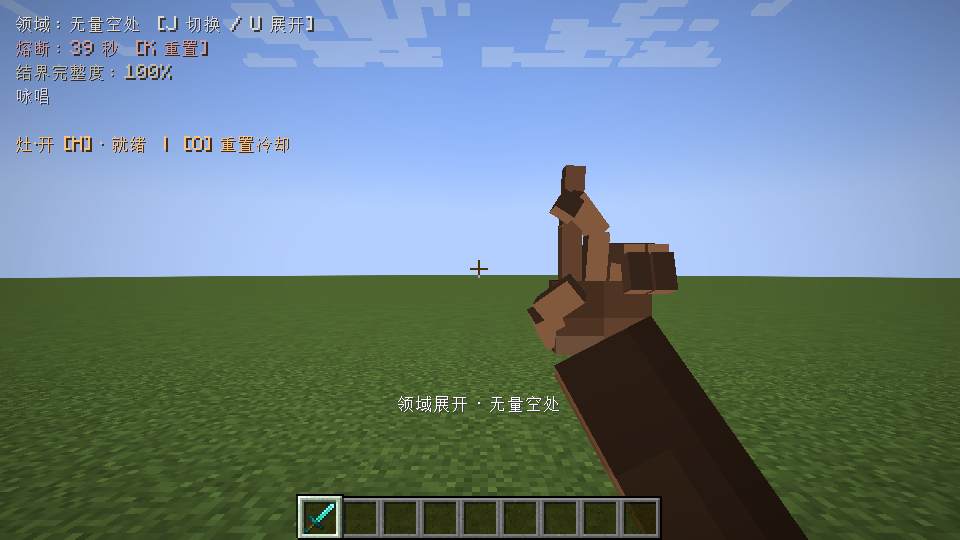
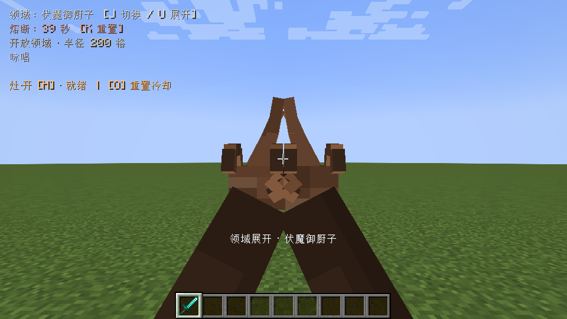
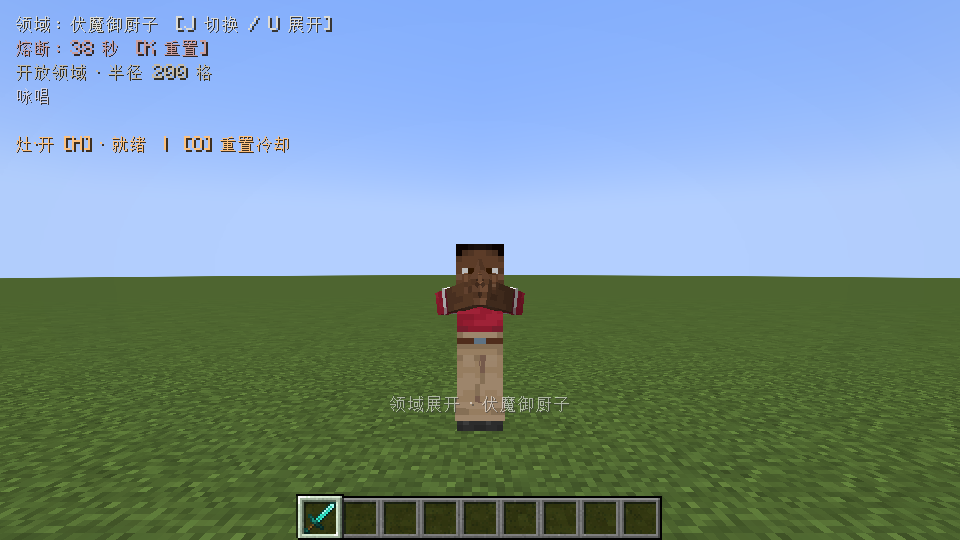

# 1.2.0 范围伤害与领域结印验证

日期：2026-10-27。Windows、Java17、Minecraft1.20.1、Forge47.4.20。测试由独立启动器创建全新平坦测试世界，未打开原游戏存档。

正式构建通过161项无窗口检查（49项时序、97项战斗/渲染/结印规则、15项神龛地面）。独立实例运行分别记录`DOMAIN_SEAL_TEST_COMPLETE`；正式JAR的70个生产类与实测测试包逐字节一致，不含测试入口。

## 实机战斗与配置迁移

预置旧默认TOML的16格/32点/80点组合，实际Forge加载后保存为200格/240点/480点，迁移版本为1；地形破坏保持关闭。自定义组合的保留条件可查看`FugaBalanceMigration`。

在真实集成服务端调用生产伤害结算，提前为测试夹具加载并保留远处区块；能力本身没有新增强制加载行为。记录Forge伤害事件：

| 测试目标 | 实际伤害（生命值） |
| --- | --- |
| 距落点约3.65格 | 236.71747 |
| 距落点约110格 | 140.99876 |
| 距落点约198格 | 61.799313 |
| 距落点210格 | 0 |

重复脉冲没有再次命中相同目标。此处验证真实伤害结算及边界，没有将测试驱动的脉冲调用描述为重新执行完整H键射出与落点流程。粉尘480点的边缘衰减另有无窗口规则检查，粉尘消耗玩法沿用1.1.0实现。

## 领域手势

通过真实U/J/K按键映射展开两种领域并切换第一、第三人称，截图确认皮肤手臂和手指模型显示。验证五条咏唱结束后收手、宿傩主动取消后清理，以及原持有的钻石剑仍在手中。两种手势使用已有的服务端领域主人、类型和时间状态同步。







同一套检查也在Oculus1.8.0、Embeddium0.3.31、Complementary Reimagined5.2.2实际启用的管线中完成，通过反射确认`IrisRenderingPipeline`，并目视检查两种第一人称及第三人称手势截图。只覆盖此组合；本轮不涉及新的录音和人工试听。

本地证据目录：`build/fuga-combat-plain-seals-120-d/host`、`build/fuga-combat-shader-seals-120-shader-a/host`。前几轮夹具检查因自然生成动物挤占命中预算而失败，最终夹具清理非目标后通过；未通过的运行没有计为成功。

## 复现

```powershell
.\gradlew.bat --no-daemon -PvisualTest=true jar
python tools/run_fuga_qa.py --minecraft-root E:\.minecraft --java <JDK17的java.exe> --mode plain --suite seals --run-id unique-id
```

测试代码只打入显式`visual-test`构建，不分发到正式JAR。完整1.1.0双客户端与八组并发测试记录保留在[FUGA_COMBAT_VALIDATION.md](FUGA_COMBAT_VALIDATION.md)，本版没有声称所有测试组合都被覆盖。
