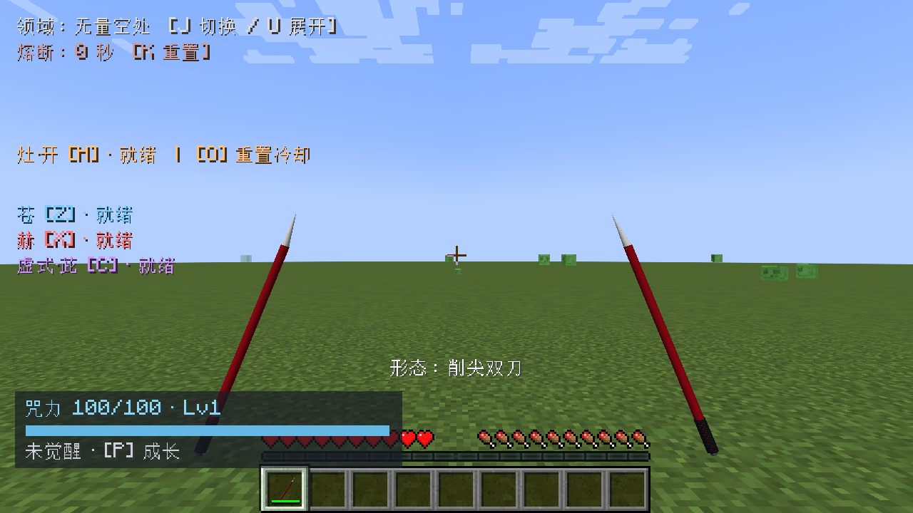
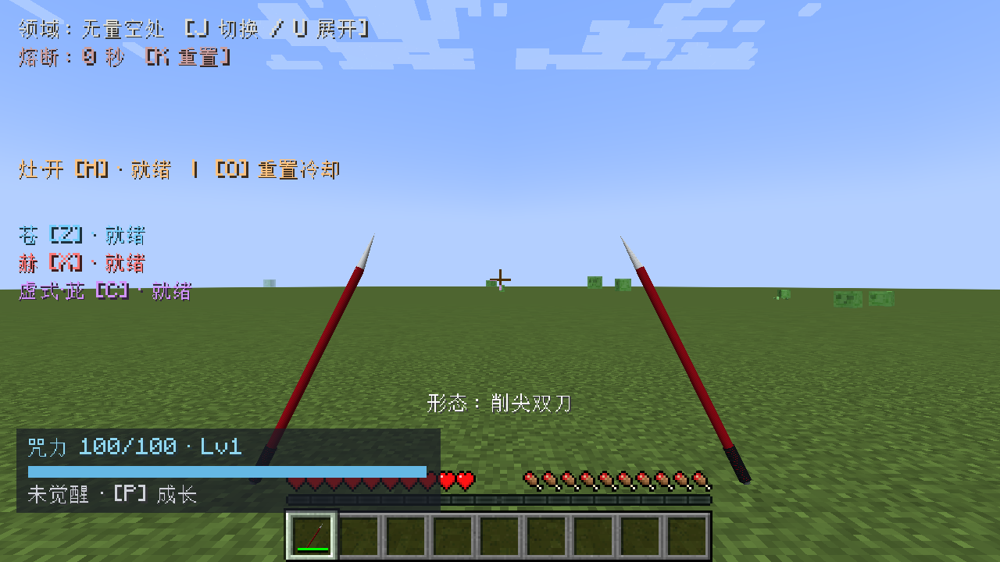

# 1.12.1：游云双刀第一人称热修复

修复1.12.0双刀视角中武器过大、两侧握持变换不一致，以及额外绘制的副手皮肤手臂穿过画面中央的问题。

- 两把刀使用统一、镜像的相机坐标变换；拦截两个原版手部绘制通道后只绘制这一对视图模型，避免主手原版路径与副手自定义路径叠加。
- 移除错误的独立副手手臂绘制。沿用原版手持工具的表现，不再出现横贯准星的皮肤方块。
- 双刀第一人称模型缩放从0.75调为0.42，并调整握持高度、倾角。物品栏与第三人称实际网格尺寸不变。
- 自定义双刀不再套用原版单手缓存的装备高度，避免耐久、形态或主手设置更新后落到屏幕外。

伤害、攻速、触及距离、三种形态操作、副手占用保护与物品数据结构均保持1.12.0规则。切回其他形态、使用其他物品或退出双刀后恢复原版绘制路径。

## 验证

使用独立新世界复验原44项咒具/形态检查，并检查静止、挥击及左手设置下的第一人称截图。普通生产构建运行14278项规则检查；正常JAR排除测试类。原始测试目录和截图记录在本地构建证据中，公开安装文件校验值见Release的SHA256SUMS.txt。

这次仅针对第一人称渲染，未重跑1.12.0的65秒双客户端群战或光影专项。更新客户端和服务端到同一1.12.1版本，移走旧版同模组后重启。
