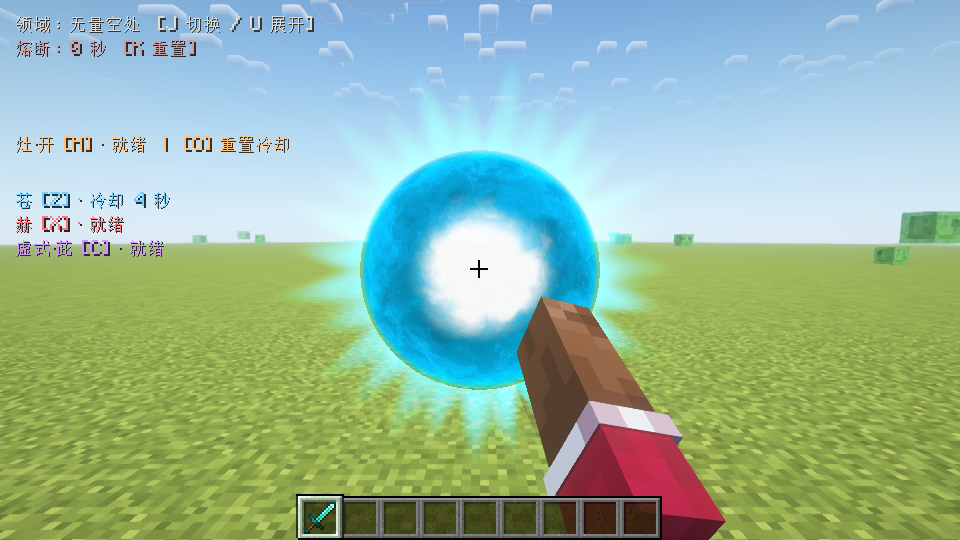
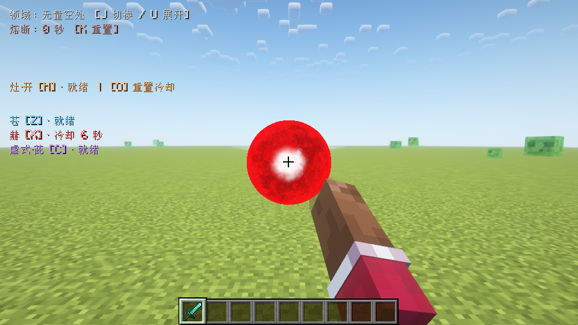
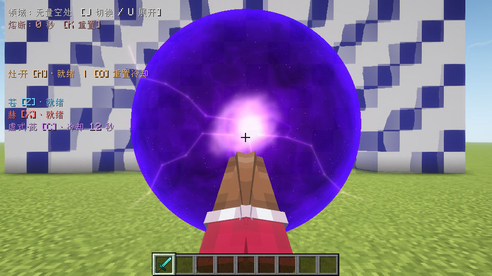
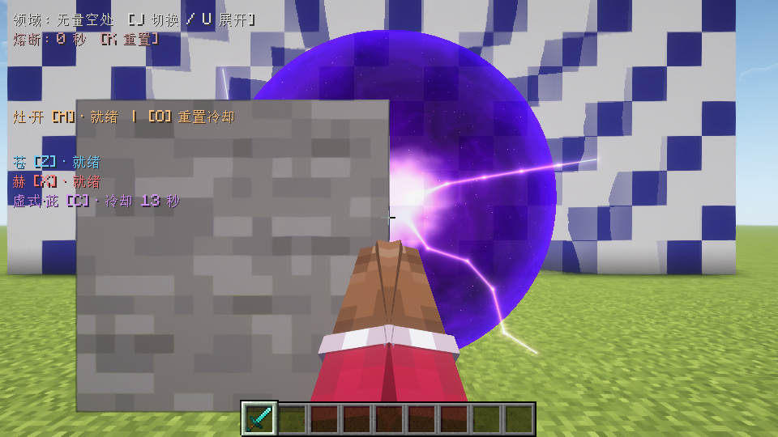

# 1.4.0 球体与融合特效

2026-10-27。按参考图区分独立苍/赫与合成茈时的两颗深色云纹球；参考素材未加入仓库，下列图片均为独立测试世界的实机截图。

## 实机画面

## 渲染方式

用相机射线求球面/拉伸球面的交点；能量云纹由三维噪声随时间流动，独立苍、赫与融合材料使用不同着色。茈内部加入细星点和随时间改变的折线闪电。球体外圈折射屏幕背景，属于光学近似，不移动实际世界几何。

世界粒子阶段保存相机矩阵和世界深度，在世界与光影最终合成后、界面绘制前绘制球体，保留手部深度。每个球绘制前更新颜色缓存，避免后画球的折射抹掉前一个球。结束时恢复调用方帧缓冲、视口、颜色掩码、深度、混合、纹理和程序状态；没有效果或退出世界时释放缓存。

每帧最多32个代理四边形，颜色缓存限制在1280×720以内，深度保持当前视口尺寸。该上限与CPU提交时间不能替代GPU性能或帧率测试；未宣称所有显卡、光影和整合包兼容。

## 验证范围

Minecraft 1.20.1、Forge 47.4.20、Java 17、960×540独立客户端新世界；分别运行普通画面与Oculus 1.8.0 / Embeddium 0.3.31 / Complementary Reimagined 5.2.2。截图目视检查独立苍/赫、融合前、接触、成型、飞行和前景遮挡；光影管线通过运行时检查确认真实启用。

运行同一套完整术式检查：苍蓄力/引力/队友保护，赫伤害/击退，茈路径单次命中/160点伤害/墙体阻挡，地形开关与基岩保护，声音去重、旁观取消及声道清理，渲染资源与帧缓冲恢复。测试专用入口不会装入正式JAR。

普通实例37项、光影实例38项检查通过，分别以`LIMITLESS_TEST_COMPLETE shader=false/true network=false`结束，无`LIMITLESS_FAIL`。证据目录为`build/fuga-combat-{plain,shader}-orbs-140-release/host`。本轮采样最多同时5个球体代理，未将其当作32代理上限压力验证。正式包的86个生产类、3个新着色器和音频资源与实测专用包逐字节一致，并通过161项既有无窗口检查。

本轮仅改客户端特效，未重复多人联网检查；该项仍以[1.3.1双客户端记录](LIMITLESS_AUDIO_VALIDATION.md)为准。没有打开或修改用户原存档；没有用测试通过代替人工音效试听。
