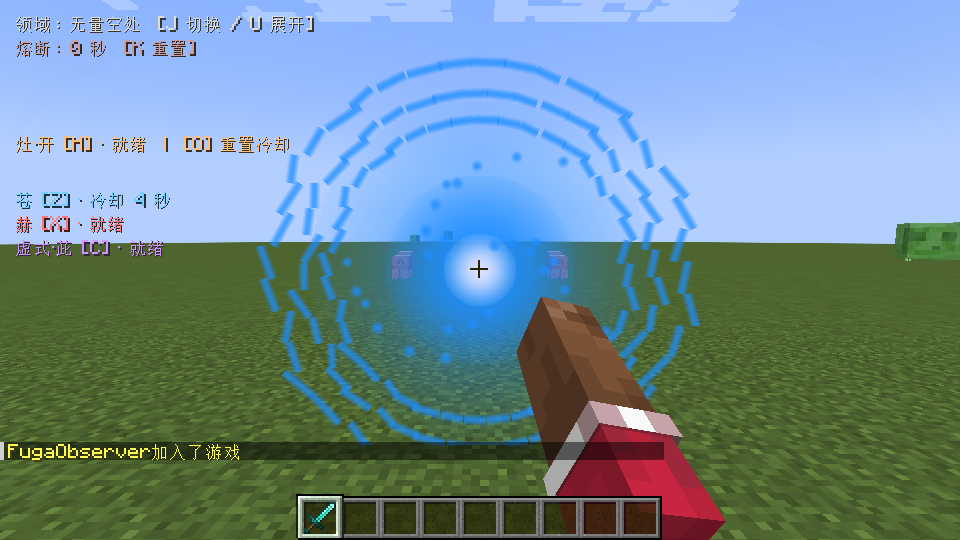
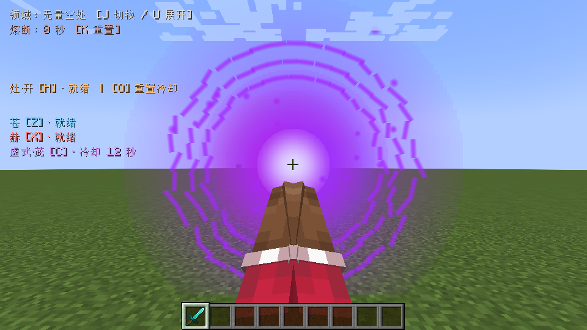
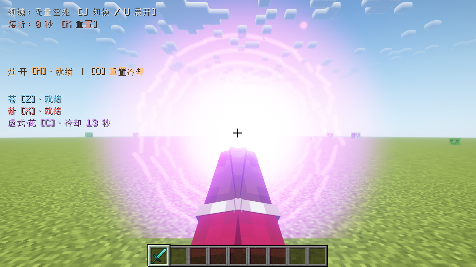

# 1.3.0 苍、赫与虚式·茈验证

2026-10-27，Windows、Java17、Minecraft1.20.1、Forge47.4.20。使用独立身份、新目录和全新平坦世界；没有读取原存档。

正式构建通过既有161项无窗口规则检查。新增术式使用真实Forge运行验证：双客户端套件的主机29项检查、远端3项检查，以及单客户端光影套件30项检查均通过。正式JAR不含测试入口，其81个生产类与实测专用JAR逐字节一致。

## 战斗与同步

- 通过真实Z/X/C按键映射施法，Z按住达到40tick满蓄力。苍在地面上方悬浮，持续脉冲伤害并将目标拉近，队友不受影响。
- 赫造成超过35点伤害并将测试目标向外击飞，远处目标不受这次局部爆发生效。
- 茈连续命中14、28、46格附近的三个测试目标，每个目标收到一次160点基础伤害；石墙后的70格目标没有被命中。
- 默认保留石墙；另一次施放手动开启独立地形开关，触发83次Forge破坏事件并清除射线路径的石墙，基岩保持完整。每步检查/破坏上限由生产代码约束，83不是单tick数量。
- 施术者受保护，原持有的钻石剑没有被移动或替换。重置能清除术式冷却；转为旁观后，服务端施法和客户端姿态均清理。
- 第二个真实客户端通过127.0.0.1 TCP接入，接收苍与茈的融合状态。它不是本地伪造观察者。没有将本机网络测试等同于公网延迟压力测试。
- 首轮三个术式各触发一次汇聚声和一次发射声；每2tick重复快照没有重播这些音效。使用OpenAL无输出后端观察实际声源事件，未声称人工耳听验收。

## 画面

目视检查蓝色汇聚、引力区域、红色爆发、苍赫分离及紫色融合画面。原版方块手臂保留，无手指模型。修正了近距离发射时的紫色光晕遮满视野问题。

同一完整套件在Oculus1.8.0、Embeddium0.3.31、Complementary Reimagined5.2.2中通过；通过反射确认真实`IrisRenderingPipeline`，并目视检查截图。没有重跑旧版八组灶·开并发性能基准，也不宣称覆盖所有光影或整合包。

## 复现与证据

先构建`-PvisualTest=true jar`，再运行`tools/run_fuga_qa.py --suite limitless --mode network`或`--mode shader`，其余必需参数见工具帮助。普通发布包不包含测试代码。

本地证据：`build/fuga-combat-network-limitless-130-net-b/{host,observer}`与`build/fuga-combat-shader-limitless-130-shader-b/host`，日志分别结束于`LIMITLESS_TEST_COMPLETE`、`LIMITLESS_OBSERVER_COMPLETE`。初轮无AI夹具不能响应运动，以及创造模式持剑影响采矿事件的问题均在最终套件前修正；失败运行未计为通过。
