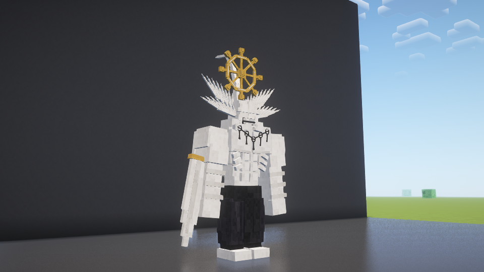
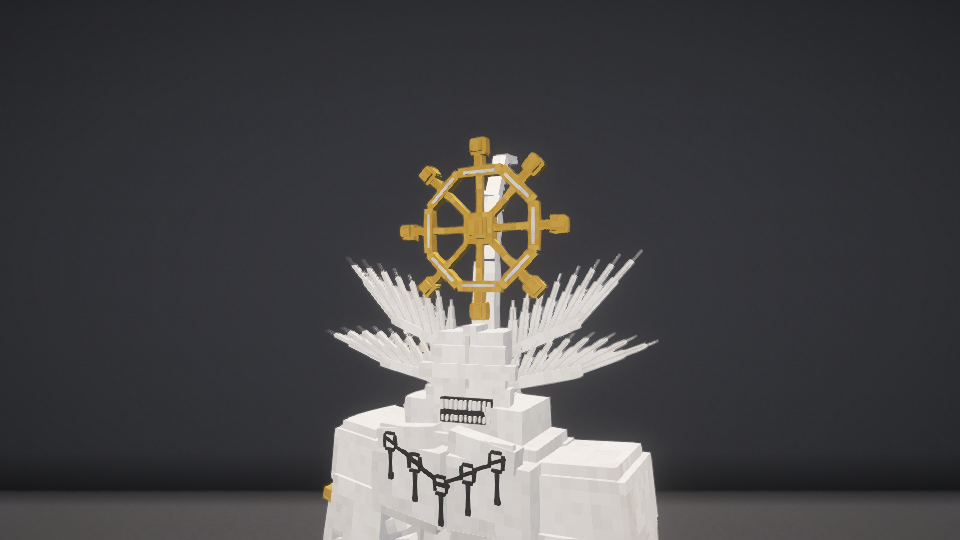

# 羽翼、轮盘与参考造型 · 1.10.4

2026-10-29。本地更新，GitHub正式版仍为1.10.0。

按用户更清楚的参考图片，将眼侧光滑长角改为两对连接在翼骨上的分层尖羽片，增加细羽轴；轮盘竖向朝前、缩小比例并提亮金色，轮端增加削角结构。新增向后弯曲的头冠、腰后白色飘带、环状垂饰，改为黑裤，缩窄嘴部并增加上下细齿。保留1.10.3高挑站姿和原有成长/变身玩法。

## 验证

- 正常构建703项检查通过，普通包没有VisualTest入口。
- 与本轮实机测试包逐字节比较，199个生产类/素材条目一致。
- 与已安装1.10.3逐类比较，唯一变化的生产类为客户端MahoragaModel；服务端玩法类均保持原字节。本轮没有把既有战斗测试记为重新执行。
- build/fuga-combat-shader-maho-feather-fan-final：120项检查通过，有MAHORAGA_TEST_COMPLETE且无场景FAIL，包含真实光影管线、模型/资源、轮盘转动、概率判定、成长同步与NBT。
- 早期近景取景偏远及下层羽片过于聚拢，调整扇形角度和拍摄机位后重新采集；所列截图来自最终模型。

SHA256：397340f597c036997bd3caed1f175c8abf337911b20deed133de976d34e5c85e。

本轮未重测远程多人、完整退出重开存档及大量实体性能；音频设备No Output。全部测试使用独立新世界，没有启动、关闭或修改用户原游戏和存档。
