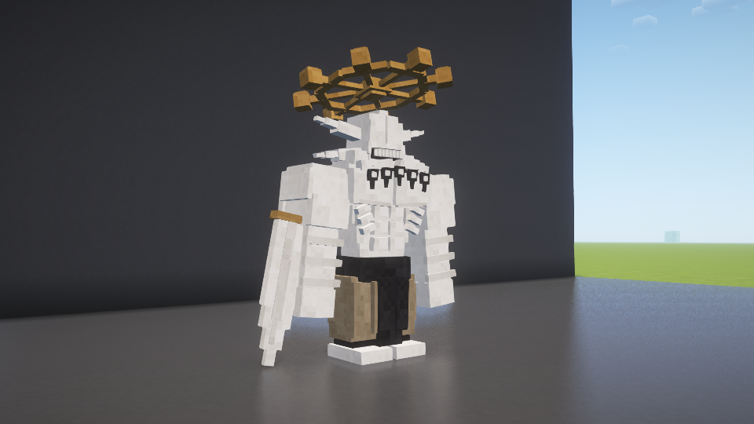

# 魔虚罗壮硕轮廓与无上限成长 · 1.10.2

2026-10-29。本地更新，GitHub正式版仍为1.10.0。

模型收窄腰腹、裤型和手臂，保留肩胸，胸背逐级向腰部收拢。成长改用独立长整数计数；每次完成适应增加原始大小5%，不设置游戏体型上限。抗性满四级后继续承受对应有效攻击，每3次命中且间隔3秒（茈8秒）仍能成长。身体、碰撞、眼高和近战触及范围一起变化；抗性上限、生命及空间斩射程不额外叠加。

旧存档从已有适应等级迁移初始成长次数；新存档保存GrowthCount，读档不会退回32次或2.6倍。无下限协议7，客户端和服务端均需1.10.2。保留1.10.1默认50%一次性濒死变身。

验证：正常构建703项检查通过。正常包不含测试入口，199个生产类/素材条目与实机测试包逐字节一致。

- build/fuga-combat-shader-maho-lean-model：120项实机检查通过，包含新模型、实际光影管线、概率变身与体型同步。
- build/fuga-combat-plain-maho-unbounded-combat：45项实机检查通过，包含超过原上限的3倍实体、满抗性后真实受击成长到3.05倍、NBT保留41次成长与超过10格的碰撞高度，以及原有适应/召唤/战斗/退场回归。
- 纯规则同时检查100次和10000次成长仍递增，未将高次数完整巨型战斗或长期性能表述为实测通过。

SHA256：aa8931d29c0ce373c916a9870cb11305d3fb405fa0669d3a2ca8666f39674091。

没有重测远程多人、完整关闭重开世界、极大体型寻路或大量实体性能。原游戏与原存档未启动、关闭或修改。
