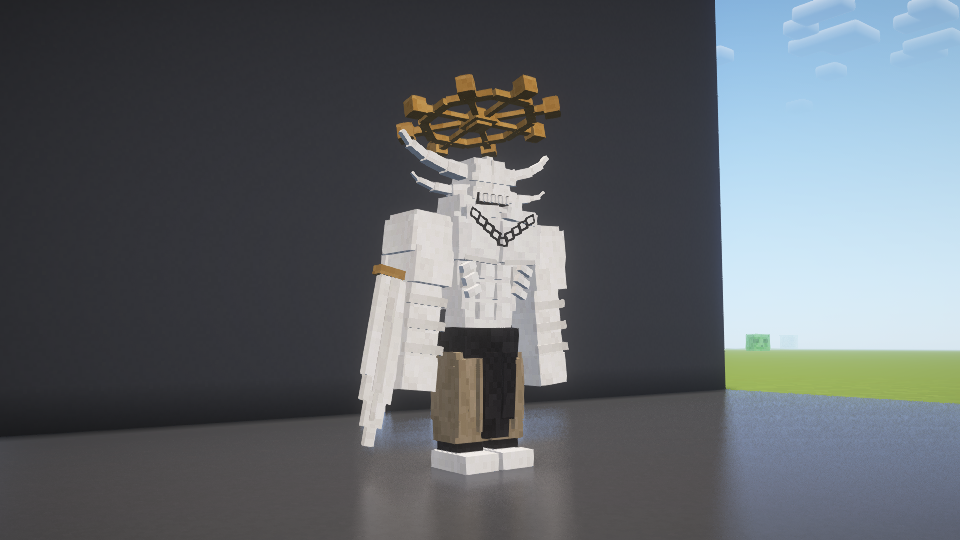
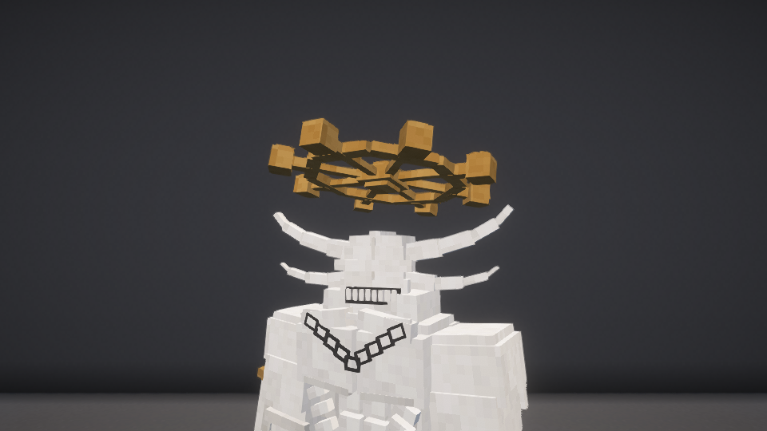

# 参考造型与高挑比例 · 1.10.3

2026-10-29。本地开发与安装，GitHub正式版仍为1.10.0。

按用户参考图重新制作两对分段上弯长角、眉梁、收尖下颌及下垂V形链纹。通过拉长腿和躯干提高身高，头宽和肩宽保持不变；基础身体碰撞高度3.3→4格，眼高3.5格。轮盘另计，脚底仍与地面相接。

保留1.10.2无上限成长与50%一次性濒死变身。客户端/服务端均需1.10.3，无下限协议7、领域协议14。

## 验证

正常构建703项通过，普通包不含VisualTest入口，199个生产类和素材条目与本轮实机测试包逐字节一致。

- build/fuga-combat-shader-maho-reference-tall-model：120项通过，基础碰撞高度4格、八次成长后5.6格、客户端成长同步及真实光影管线均通过；采集正面、侧后、头部轮盘和成长截图。
- build/fuga-combat-plain-maho-reference-tall-combat：前40个检查点通过，含真实伤害、持续成长、保存、无下限命中、领域内适应行动、真实召唤与升起。随后独立接敌断言失败，不把该完整运行记为通过。召唤者同时攻击同一目标会引入伤害保护时序干扰，因此重测时将召唤者移到目标探测范围外，保持其AI启用和主人关联。
- build/fuga-combat-plain-maho-reference-owned-isolated：调整隔离条件后召唤、独立命中、主人NoAI暂停、主人死亡及退场完整通过，有MAHORAGA_COMBAT_TEST_COMPLETE且无场景FAIL。失败原目录保留，未修改生产伤害或AI来绕过测试。

SHA256：6f64595d964c4025e548e5821f267416ace4b701fa4c429b8fe7bb7d85f8fd3a。

未重测远程多人、完整退出重开存档和大规模/极大体型性能。所有实机测试为独立新世界，未进入或修改用户原存档。
