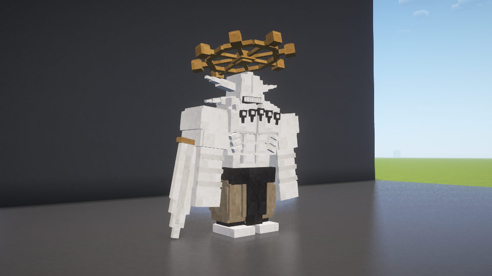

# 魔虚罗细化、成长与概率变身 · 1.10.1

日期2026-10-29。本轮仅本地开发和安装，GitHub正式版仍为1.10.0。

- 高专→觉醒、惠皮→原身默认50%，每名角色一生判定一次。失败标记保存于DangerTransformationRolled，不因再次受伤、回血或NBT读取重抽。主动交付眼罩/手指仍确定变身，已生成的最终形态不回退。
- 魔虚罗每完成一级适应增加5%线性体型，八类四级最高2.6倍；约1秒平滑过渡。渲染、物理碰撞体、眼高和近战范围同步，保存后由适应等级恢复。生命和空间斩射程不随体型额外增加。
- 新增肩锁骨、肋侧肌肉、脊柱、脸部层次、渐细侧鳍、剑脊/护手及轮盘轮毂/饰条。

## 验证

正常构建701项检查通过（原667加34项成长边界/递增检查）。正常包不含VisualTest入口，199个生产类与素材条目与本轮实机测试包逐字节一致。

| 独立游戏目录（build/） | 检查 | 结果 |
| --- | --- | --- |
| fuga-combat-shader-maho-refine-model-b | 光影模型、0/50/100%判定边界、失败反复尝试和保存后不可重抽、失败后致死、成功后满血、八次适应后1.4倍碰撞及客户端成长同步 | 120项通过 |
| fuga-combat-plain-maho-refine-combat-b | 真正受到重复苍命中后成长、伤害与力量适应、无下限命中、领域内适应行动、召唤战斗及退场 | 42项通过 |
| fuga-combat-plain-maho-refine-npccombat | 成功觉醒立即茈、濒死自爆、贴脸茈、反转回血及原有战斗 | 85项通过 |

每场均有对应TEST_COMPLETE且无场景FAIL。旧model-a出现过客户端读档后体型追赶过慢的断言失败；修复为固定20tick成长过渡后以model-b复测通过，失败目录保留。

SHA256：`b416d8fb60fd77076649066b2a68f6f8f3ce144524eebde6fb5b2a5924d1ab26`。

本版没有重测远程多人、完整存档关闭重开或大量巨型实体性能。原游戏和存档未启动、关闭或修改；测试均为独立新世界，音频设备No Output不作为人工听音验收。
