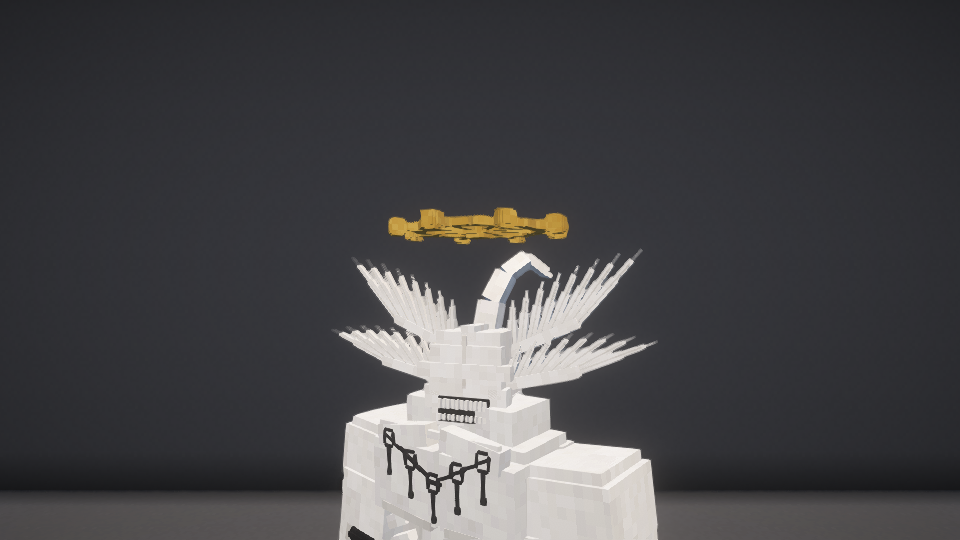
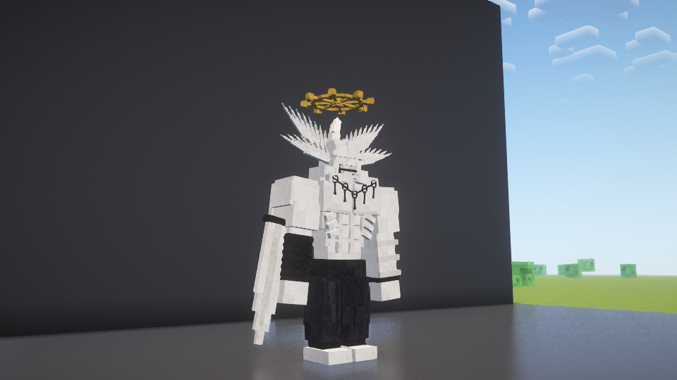

# 水平法轮与参考纠正 · 1.10.5

2026-10-29。本轮本地安装。

根据用户明确纠正与新的手办参考，法轮改为水平悬在头顶。八个端头用相交的削角方块近似球状；弯头冠向侧后方回弯，并与轮盘保持可见悬浮间隙。新增右臂黑色缠布、左腕黑环，剑刃护手改为黑色。

保持4格高的基础身体、羽翼状眼侧结构、无上限成长与50%一次性濒死变身。客户端/服务端均需1.10.5。

验证：正常构建703项通过，正常包不含测试入口。199个生产类/素材条目与最终实机测试包逐字节一致；相对1.10.4唯一变化的生产类为客户端MahoragaModel，服务端玩法类保持原字节。

build/fuga-combat-shader-maho-wheel-floating-final：120项实机检查通过，有MAHORAGA_TEST_COMPLETE且无场景FAIL。真实光影管线下采集正面、侧后和头部近景；确认水平法轮、冠状结构和悬浮间隙。先前取景用于定位冠状结构挨轮盘过近的问题，最终截图来自修正后的模型。

SHA256：bf8ade0598c0c50e1af50791031f36e10c2dbd4fd35b11237c47eb26721420c1。

本轮没有重新执行战斗、远程多人、完整退出重开存档和长期性能验收；模型测试均为独立新世界，未进入或修改原游戏和存档。
