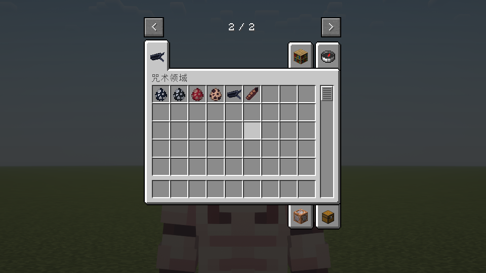
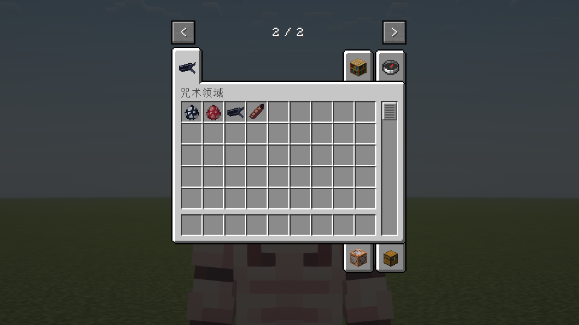

# 皮肤NPC与物品变身 · 1.7.2

本版按用户提供的四张64×64皮肤使用原版玩家模型，不再使用1.6.x自制的立体发型、墨镜或制服模型。保留皮肤本身的外层，按皮肤分别采用经典/纤细手臂。

## 两条变身路线

- 高专五条悟：深色高专制服皮肤（Suguru_Nobara文件，纤细手臂）。手持【眼罩】右键后，变为新宿五条悟（Boy_Sweatpants文件，经典手臂）。
- 虎皮宿傩：b0059d77b9487888皮肤，只将服装换成深色高专制服、红兜帽/袖口和黑红鞋。头发、脸、手部原像素和UV不变。手持【宿傩的手指】右键后，变为720b8352ce7efeed原身皮肤（纤细手臂），该图保持原样。

此版原身宿傩仍按提供的原版玩家皮肤展示，并非额外四臂模型。

生存模式每次首次变身消耗一个对应物品；创造模式不消耗。错误物品不会变身或消耗，已完成变身后重复交付不再消耗。转换不重建实体，不重置位置、血量或UUID。变身状态写入实体NBT并同步客户端；旧NPC存档无此字段时默认初始形态。

## 获取与生成

所有模组物品统一位于独立创造模式栏【咒术领域】（眼罩图标）：四种生成蛋（高专五条、新宿五条、虎皮宿傩、原身宿傩）、眼罩、宿傩的手指。已从原版“生成蛋”和“原材料”分类移出；仍可通过创造模式搜索找到。如果栏位较多，使用创造界面翻页箭头查找。也可使用：

```mcfunction
/give @s unlimitedvoid:student_gojo_spawn_egg
/give @s unlimitedvoid:sukuna_16_spawn_egg
/give @s unlimitedvoid:shinjuku_gojo_spawn_egg
/give @s unlimitedvoid:true_sukuna_spawn_egg
/give @s unlimitedvoid:blindfold
/give @s unlimitedvoid:sukuna_finger
/summon unlimitedvoid:student_gojo ~ ~ ~2
/summon unlimitedvoid:sukuna_16 ~2 ~ ~2
/summon unlimitedvoid:shinjuku_gojo ~ ~ ~2
/summon unlimitedvoid:true_sukuna ~2 ~ ~2
```

新增两种生成蛋直接生成最终形态，不需要先交付变身物品；直接生成的新宿五条仍自带“无限”。两种新形态拥有各自的实体ID，保存/重新加载保持最终形态。原有初始形态生成蛋和物品变身路线保留。

需要作弊或指令权限。NPC不自然生成，不游走或自动攻击/施放领域，会看向附近玩家，有40点生命值。五条新增被动“无限”防御，宿傩仍正常受伤。已有NPC使用相同实体ID，重启后切换到新皮肤表现。

## 五条被动“无限”

高专五条默认具备，新宿形态继承。阻挡原版普通玩家/生物近战和标记为投射物的伤害；附近朝屏障飞行的投射物逐渐减速，不反弹伤害。每NPC每tick最多处理附近4格内64个投射物，不强加载区块，不修改投射物所有者或重力开关。接触时显示少量白色粒子。

这不是无敌开关：环境、非投射物魔法、当前领域必中伤害以及绕过无敌的伤害（如`/kill`）不被统一拦截。当前苍/赫/茈等术式的服务端自定义伤害没有统一归入普通投射物，不宣称所有其他模组攻击均已适配。配置`gojoInfinity=false`可关闭此被动。NPC仍不自动战斗。

## 皮肤与资源

源文件及哈希见[supplied-skins.json](supplied-skins.json)。皮肤为用户提供，不将其声称为本项目原创MIT资产。三张皮肤逐字节复制，虎皮宿傩只编辑约定服装掩膜；生成/验证脚本为`tools/prepare_supplied_skins.py`。手臂原图宽度分别匹配经典或纤细模型。两张功能物品图标为项目新绘制的32×32像素图。

当前为本地安装版本，未发布GitHub Release。源皮肤的作者和公开再分发许可尚未核验，本轮不向GitHub上传这些用户提供图片。

## 1.7.2验证

250项既有规则检查通过；指定光影独立新世界62项NPC/创造栏/防御/变身检查通过，含两种新蛋实际使用、直接最终形态、实体类型与形态NBT恢复、无形态字段时默认最终形态、重复交付不消耗、新宿继承无限、Forge取蛋映射与原蛋映射保留、客户端同步。此轮取蛋检查是Forge映射验证，没有模拟实际鼠标中键输入。

日志：`build/fuga-combat-shader-npc-172-final-b/host/console.log`。正常包生产类及assets与该测试包逐项匹配，不含测试入口；既有皮肤不变。没有重跑远端多人或完整退出/重开世界，存档检查为实体NBT恢复。



## 1.7.1验证（历史）

常规build的250项规则检查通过。指定光影隔离新世界完成47项实机检查，含四物品独立创造栏、移出原版分类、真实Forge第二页栏图标与内容、普通近战/箭矢防御、箭矢减速、不修改重力、宿傩正常受伤、间接魔法与kill绕过、配置关闭，以及全部既有物品变身/NBT同步回归。正常包生产类和assets与最终实机测试包逐项匹配，不含测试入口。四张皮肤及已有术式类与1.7.0一致。

日志：`build/fuga-combat-shader-npc-171-ui-final/host/console.log`。未重跑远端多人或长期投射物/大量NPC性能测试。领域伤害例外本轮使用相同的间接魔法伤害源验证，未重新展开完整领域战斗。



## 1.7.0验证（历史）

250项既有规则检查通过。隔离新世界指定光影实机35项检查通过，包含生成蛋、物品交互、两条变身路线、生存各消耗一个、重复/错误物品不消耗、创造不消耗、UUID/血量保留、变身NBT恢复、旧存档缺字段回退、客户端形态同步与四张皮肤资源。正常包全部生产类与assets匹配实际测试包，不含测试入口。日志：`build/fuga-combat-shader-npc-170-forms/host/console.log`。

三张用户皮肤与源文件SHA256完全相同；虎皮宿傩脚本断言所有修改像素均位于服装掩膜，头部和手部原像素完全相同。目视检查变身前后实机截图。未重跑远端多人、完整退出重进世界和全硬件性能验证；NBT恢复检查不等于完整重启测试。


历史1.6.x记录见Git历史。
