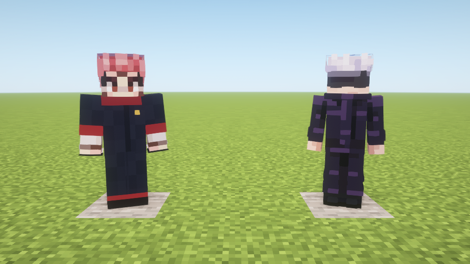
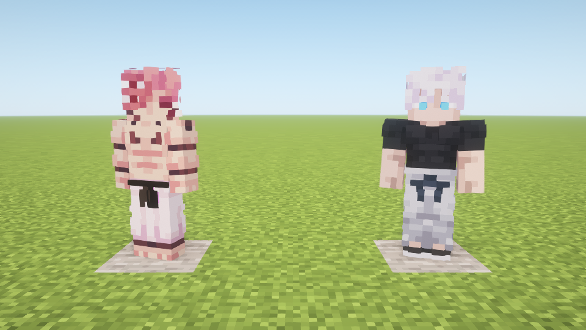

# 皮肤NPC与物品变身 · 1.7.0

本版按用户提供的四张64×64皮肤使用原版玩家模型，不再使用1.6.x自制的立体发型、墨镜或制服模型。保留皮肤本身的外层，按皮肤分别采用经典/纤细手臂。

## 两条变身路线

- 高专五条悟：深色高专制服皮肤（Suguru_Nobara文件，纤细手臂）。手持【眼罩】右键后，变为新宿五条悟（Boy_Sweatpants文件，经典手臂）。
- 虎皮宿傩：b0059d77b9487888皮肤，只将服装换成深色高专制服、红兜帽/袖口和黑红鞋。头发、脸、手部原像素和UV不变。手持【宿傩的手指】右键后，变为720b8352ce7efeed原身皮肤（纤细手臂），该图保持原样。

此版原身宿傩仍按提供的原版玩家皮肤展示，并非额外四臂模型。

生存模式每次首次变身消耗一个对应物品；创造模式不消耗。错误物品不会变身或消耗，已完成变身后重复交付不再消耗。转换不重建实体，不重置位置、血量或UUID。变身状态写入实体NBT并同步客户端；旧NPC存档无此字段时默认初始形态。

## 获取与生成

生成蛋位于创造模式“生成蛋”，眼罩/手指位于“原材料”。也可使用：

```mcfunction
/give @s unlimitedvoid:student_gojo_spawn_egg
/give @s unlimitedvoid:sukuna_16_spawn_egg
/give @s unlimitedvoid:blindfold
/give @s unlimitedvoid:sukuna_finger
/summon unlimitedvoid:student_gojo ~ ~ ~2
/summon unlimitedvoid:sukuna_16 ~2 ~ ~2
```

需要作弊或指令权限。NPC仍仅展示，不自然生成，不游走或自动战斗/施放术式，会看向附近玩家，有40点生命值并可受到伤害。已有NPC使用相同实体ID，重启后切换到新皮肤表现。

## 皮肤与资源

源文件及哈希见[supplied-skins.json](supplied-skins.json)。皮肤为用户提供，不将其声称为本项目原创MIT资产。三张皮肤逐字节复制，虎皮宿傩只编辑约定服装掩膜；生成/验证脚本为`tools/prepare_supplied_skins.py`。手臂原图宽度分别匹配经典或纤细模型。两张功能物品图标为项目新绘制的32×32像素图。

当前为本地安装版本，未发布GitHub Release。源皮肤的作者和公开再分发许可尚未核验，本轮不向GitHub上传这些用户提供图片。

## 本轮验证

250项既有规则检查通过。隔离新世界指定光影实机35项检查通过，包含生成蛋、物品交互、两条变身路线、生存各消耗一个、重复/错误物品不消耗、创造不消耗、UUID/血量保留、变身NBT恢复、旧存档缺字段回退、客户端形态同步与四张皮肤资源。正常包全部生产类与assets匹配实际测试包，不含测试入口。日志：`build/fuga-combat-shader-npc-170-forms/host/console.log`。

三张用户皮肤与源文件SHA256完全相同；虎皮宿傩脚本断言所有修改像素均位于服装掩膜，头部和手部原像素完全相同。目视检查变身前后实机截图。未重跑远端多人、完整退出重进世界和全硬件性能验证；NBT恢复检查不等于完整重启测试。




历史1.6.x记录见Git历史。
