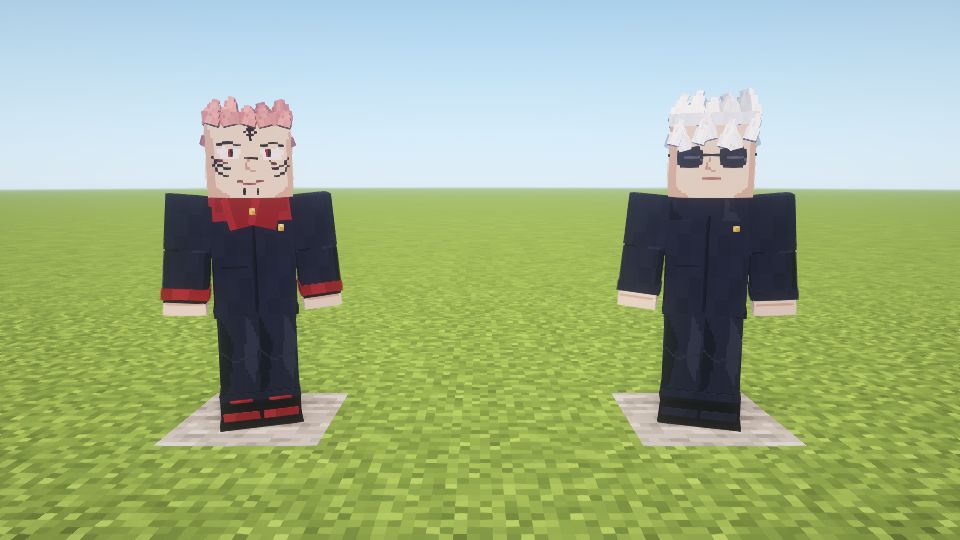
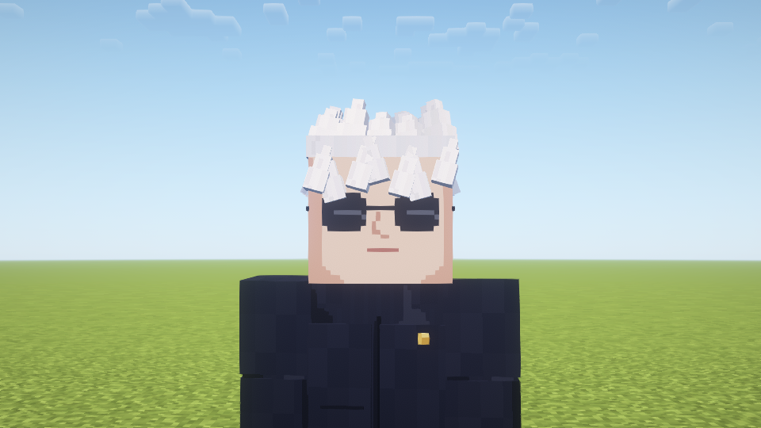
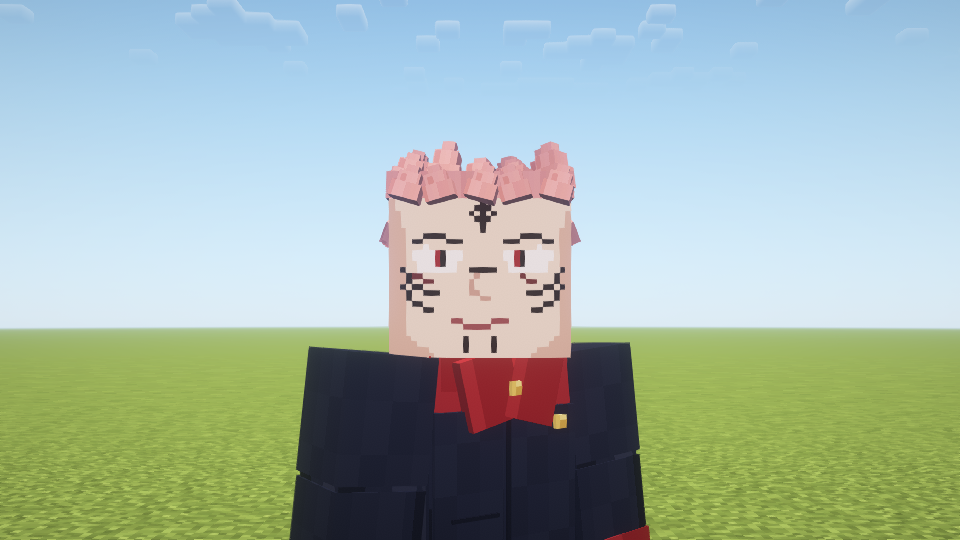
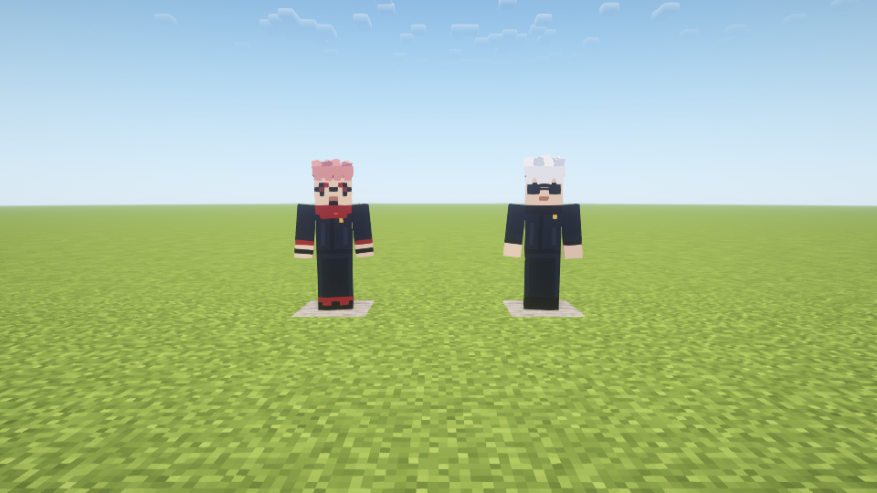

# 展示NPC · 1.6.1

新增高专时期五条悟和16指虎皮宿傩。两者采用原版比例方块人、原创256×256像素图集与分层、收尖的独立发束；五条佩黑色墨镜，宿傩使用粉发、咒纹和红领制服。当前为展示版本，16指是角色身份，不含对应战力系统。

## 生成

创造模式“生成蛋”栏内可找到两种生成蛋，也可使用：

```mcfunction
/give @s unlimitedvoid:student_gojo_spawn_egg
/give @s unlimitedvoid:sukuna_16_spawn_egg
/summon unlimitedvoid:student_gojo ~ ~ ~2
/summon unlimitedvoid:sukuna_16 ~2 ~ ~2
```

需要作弊或相应指令权限。不会自然生成，不会主动游走、攻击或释放术式。NPC会看向附近玩家，水中会尝试浮起；可被推动或受重力影响，有40点生命值，可受伤/死亡。普通距离和和平模式不会让它们自然消失，随世界实体保存。空手右键显示角色身份。非生存免伤摆件，勿用其测试领域伤害后期待实体仍存活。

## 制作与兼容

模型为代码生成的方块发型、衣领和墨镜；皮肤由`tools/generate_npc_skins.py`绘制。未下载第三方角色皮肤或模型。客户端和服务端均需安装当前1.6.1；先移出旧版同名模组以防重复加载。

眼罩与手指仍是此前的独立概念贴图，此次NPC生成蛋不依赖它们。

## 1.6.1外观重做

此前1.6.0的64×64简化皮肤和少量发块未达到概念预览的细节目标，本次重做实际模型，不使用AI概念图充当实机结果：

- 头发分为冠部、两侧、后颈与前额刘海，多段收尖并错开角度，白发刘海长短不一；宿傩额头留出咒纹区域。
- 五条的墨镜使用阶梯八边镜片、镜桥和两侧镜腿，镜框对齐眼睛。
- 制服包含独立立领/红色兜帽、前襟、衣摆、袖口、口袋边、立体金扣、裤脚、鞋底和鞋面。
- 256×256图集重新绘制眼睛、眉毛、鼻口、额头/鼻梁/脸颊/下巴咒纹、腕带及服装褶皱；没有更改战斗、NPC行为或已有实体ID。
- 先前已生成的两种NPC保留原实体，重启后使用新外观。仍无自动战斗，仍使用方块手，不增加手指。

本轮常规build的250项规则检查通过；指定Oculus1.8.0 / Embeddium0.3.31 / Complementary Reimagined5.2.2隔离新世界20项NPC检查通过，日志`build/fuga-combat-shader-npc-161-final/host/console.log`以`NPC_TEST_COMPLETE shader=true`结束。目视检查正面、五条与宿傩近照。正常包全部生产类和assets与最终实机测试包逐项匹配，不含测试入口；与1.6.0相比，既有类仅NPC客户端renderer变化，新增UV构建辅助类；NPC行为及技能实现类保持一致。

此轮没有执行全硬件性能测试、远端多人或完整退出重开世界测试。保存检查仍为实体NBT往返恢复。当前仍为本地安装版，GitHub未发布1.6.1。





1.6.0历史记录保留如下。

## 1.6.0验证范围（历史）

2026-10-28：250项规则检查通过。最终指定光影独立新世界完成生成蛋实用生成、持久实体标记、无游走/自动攻击、NBT保存与类型/位置/持久标记恢复、恢复实体加入世界、客户端同步、两张皮肤资源及真实Iris管线检查。测试日志为`build/fuga-combat-shader-npc-160-final-d/host/console.log`（NPC_TEST_COMPLETE）。目视检查正面实机截图，确认墨镜、发型、制服和咒纹显示。

正常JAR全部生产类/assets与该最终测试包逐项匹配，不含VisualTest类。原1.5.1生产类仅DomainEntities、UnlimitedVoid注册入口发生改变，技能实现类保持相同。

此前普通画面NPC检查也通过，但最终“转向附近玩家”调整后只重跑上述指定光影实例。没有启动用户原存档，没有完整退出/重开世界验证或远端多人验证；NBT恢复检查不能称为完整重启测试。版本1.6.0当前只在本地安装，未发布GitHub Release。


