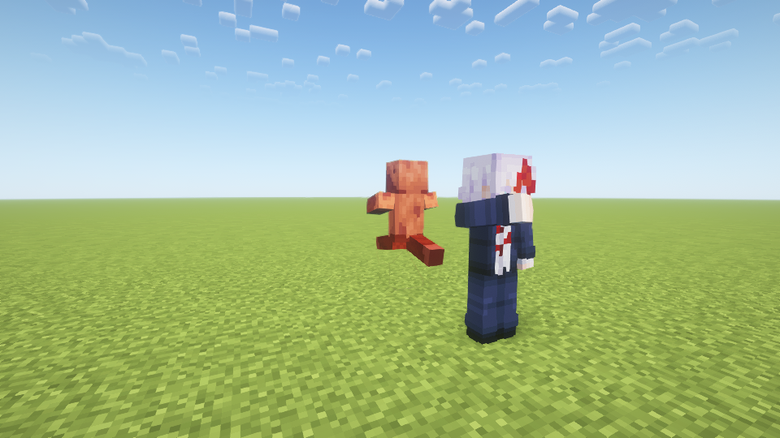

# NPC近身战斗验证 · 1.8.1

日期：2026-10-28。Java17 / Forge47.4.20，编译依赖Forge47.4.10。全部使用独立新世界、隐藏测试实例，未进入用户原存档。

## 构建与规则

正常构建通过494项检查：原有250项加244项NPC战斗规则、血量迁移、近战选择与攻击节奏检查。进阶远程仍为苍50%/赫45%/茈5%，高专远程只苍；近身为主，高专只苍拳，进阶拳击为70%苍拳/30%赫拳。首次接敌前8秒优先拳击，常规远程施放至少间隔8秒。

## 真实游戏

- 指定光影战斗套件：86项通过。日志`build/fuga-combat-shader-npc-181-melee-verified/host/console.log`，NPC_COMBAT_TEST_COMPLETE。
- 普通画面皮肤、创造栏、生成蛋、变身、存档与无限回归：69项通过。日志`build/fuga-combat-plain-npc-181-ui-final/host/console.log`，NPC_TEST_COMPLETE。受控展示使用NoAI，不代替实际战斗验证。
- 玩家原有苍/赫/茈、伤害/地形开关、声音取消与去重回归：37项通过。日志`build/fuga-combat-plain-npc-181-player-final/host/console.log`，LIMITLESS_TEST_COMPLETE。

近战场景覆盖自然寻路追击、0.34移动属性、高专连续苍拳且早期无远程、客户端收到拳击同步；赫拳起手延迟、单次28基础伤害和真实击退；高专拒绝赫拳、苍拳吸近、目标跑远取消命中、玩家保护、NoAI停拳、紧急取消动作和命中前出现墙体时取消攻击。

基础伤害测试对目标护甲设为0；普通怪物仍按原版护甲减伤。遮挡测试检查实际视线和NPC近战伤害事件，排除方块环境伤害干扰。修正了提速后强制面向目标与寻路转向冲突导致的追击停顿。

保留并回归：觉醒赫/茈分支实际伤害；学生致命伤满血觉醒并立即茈、NBT不反复回血；一次性低血自爆、反噬死后继续扩散与保护玩家；新宿自然接近原身宿傩后贴脸茈；共享8施法名额；五形态生命与旧40HP比例迁移；四类反转回血、受伤等待、再受伤重置、NBT延迟和满血封顶；自爆幸存者恢复回血。

## 资源与画面

Oculus1.8.0 / Embeddium0.3.31 / Complementary Reimagined5.2.2断言真实Iris管线。保留1.8.0全部12张纹理，不修改五张用户皮肤。

## 包与边界

正常JAR的161个生产类/资源条目逐项匹配上述三份实际运行包，不含VisualTest入口。SHA256：`fc7cbf7a36bf2e82670acc30d555f92b210ccf9a6be90d3ff51b29dd6cb2f9c3`。

无下限协议4，客户端与服务端都需1.8.1。此轮未验证远程多人、长期密集NPC性能、全部光影组合或完整退出/重进世界；NBT检查为实体保存往返。自动实机检查不能替代人工听音与完整试玩。御厨子背景在此前指定光影组合下的限制本轮未修复或复测。角色规则见[NPC指南](NPCS.md)。
