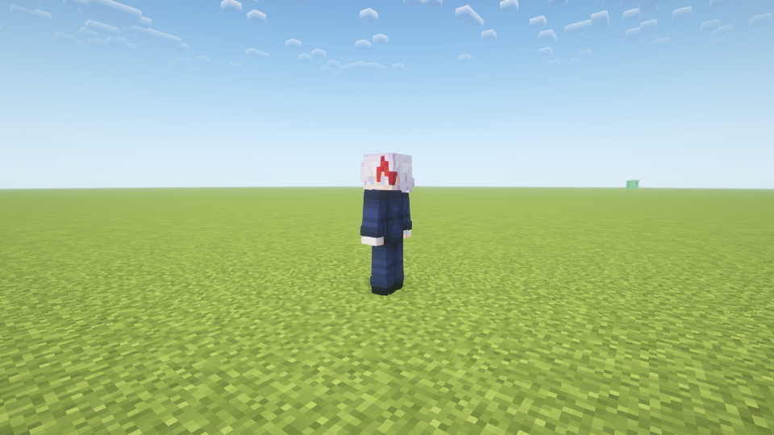
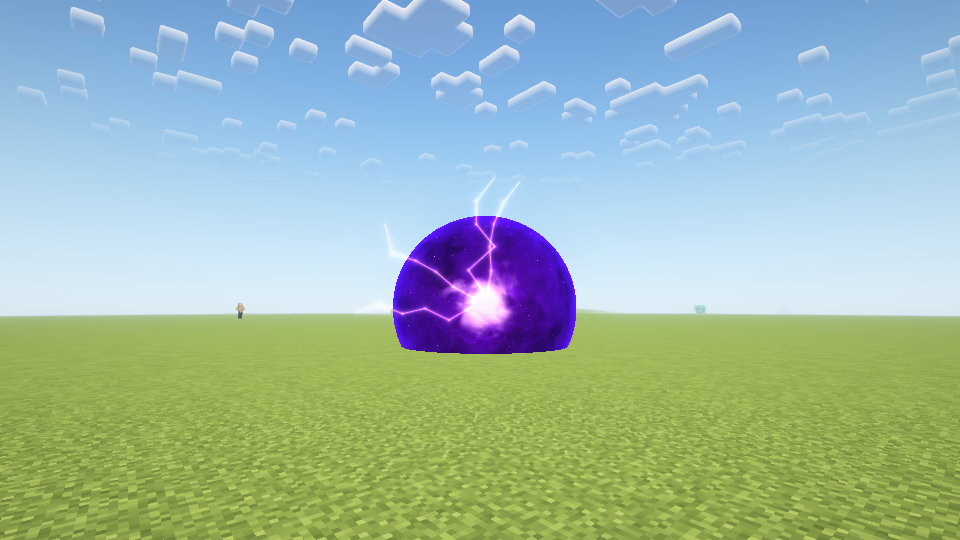

# NPC战斗与生命验证 · 1.8.0

日期：2026-10-28。Java17 / Forge47.4.20，编译依赖Forge47.4.10。全部使用独立新世界、隐藏测试实例，未进入用户原存档。

## 构建与规则

常规build运行原有250项检查，加141项NPC选择概率、低血阈值和血量迁移规则，共391项。高专100种roll均为苍，进阶种类的100种roll精确分布为50苍/45赫/5茈；5%阈值严格小于，死亡/无效血量不触发。

## 真实游戏检查

- 指定光影战斗套件：67项通过，日志`build/fuga-combat-shader-npc-180-release-combat/host/console.log`，以NPC_COMBAT_TEST_COMPLETE结束。
- 普通画面皮肤、生成蛋、变身、存档与无限回归：69项通过，日志`build/fuga-combat-plain-npc-180-release-ui/host/console.log`，以NPC_TEST_COMPLETE结束。该受控场景对NPC使用NoAI隔离外观/交互，不能代替战斗套件。
- 玩家原有苍/赫/茈战斗、伤害/地形开关、声音取消与去重回归：37项通过，日志`build/fuga-combat-plain-npc-180-release-player/host/console.log`，以LIMITLESS_TEST_COMPLETE结束。

战斗套件覆盖：自然AI高专只苍且实际伤害怪物；受控随机种子进入觉醒赫/茈分支并产生实际伤害；初次致命伤触发满血觉醒/立即茈且NBT保持；低血一次性自爆、反噬死亡后继续伤害50格外目标、玩家生存模式保护、自爆幸存后反转回血；新宿自然寻路贴脸释放茈并伤害高血原身宿傩；无敌被动继承；不攻击玩家或未变身宿傩。

还覆盖玩家/NPC共享8施法名额、满额拒绝第9个NPC与玩家施法、释放名额后玩家可接入；五种新生命上限/满血出生、旧40血无属性NBT的比例迁移；四类反转回血、受伤等3秒、再受伤重置、延迟NBT保留、满血封顶。检查不是人工听音或真实鼠标输入的完整试玩。

## 画面与资源

Oculus1.8.0 / Embeddium0.3.31 / Complementary Reimagined5.2.2断言真实Iris管线。目视检查觉醒皮肤、自爆茈成长与爆炸截图。新版皮肤逐字节复制用户源PNG；其他四张皮肤与1.7.2保持一致。

## 边界

此轮没有重跑远端多人、长期密集NPC性能、所有光影组合或完整退出/重新打开世界。保存检查为实体NBT往返恢复。Npc战斗与普通界面同为集成服务器实机，不能表述为远程多人已验收。此前御厨子背景在指定光影组合下的限制未在本轮修复或复测。数值/技能完整说明见[NPC指南](NPCS.md)。

最终正常JAR全部生产类及assets逐项匹配上述三份实际运行包（172个生产/资源条目），无VisualTest测试入口。已有1.7.2全部贴图逐字节保留，新觉醒皮肤哈希与用户原图一致。正常包SHA256：`3dad03f99584b91d6d37ceeb3f9b1548a4fdfccdb883aab96ad02029ff505aef`；本地安装文件一致。
