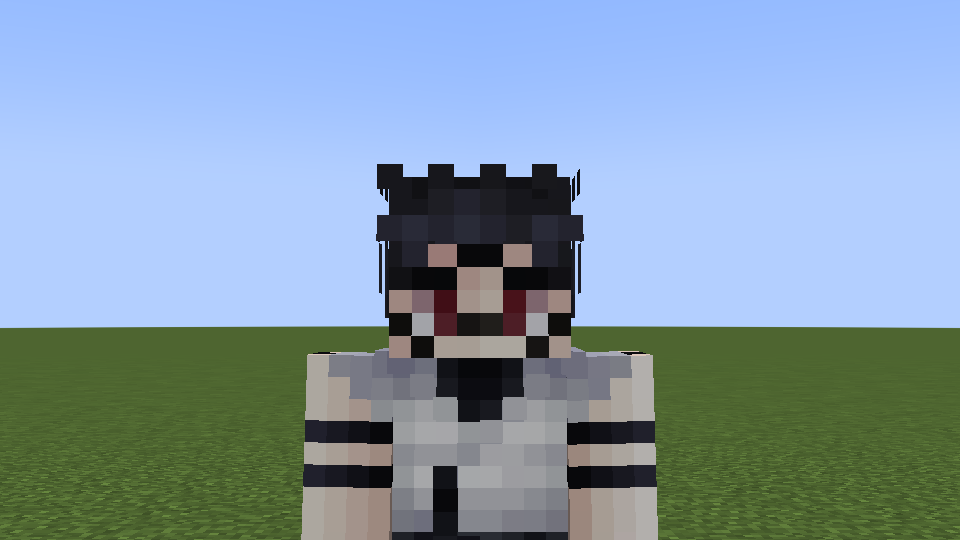
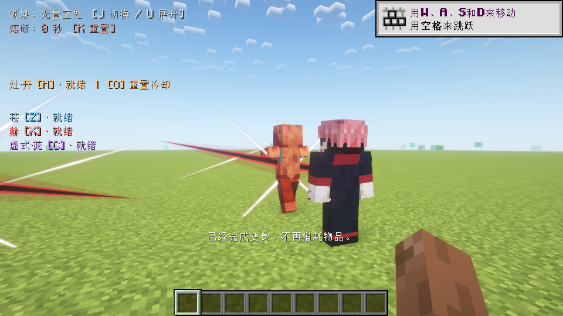
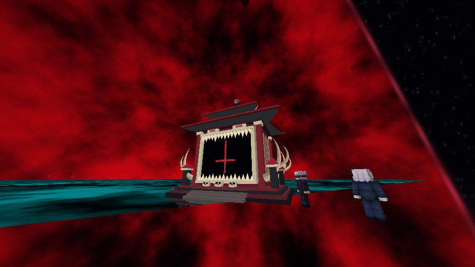

# NPC领域、宿傩战斗与惠皮验证 · 1.9.0

日期：2026-10-28。Java17 / Forge47.4.20，编译依赖Forge47.4.10。全部使用独立隐藏新世界，未进入或修改用户原存档。

## 构建与实机

正常构建通过497项规则/几何检查（原有250 + NPC247）。以下376项集成服务器实机检查通过，相关日志均以各自COMPLETE标记结束，无对应FAIL。测试实例由工具创建并自行退出。

| 独立套件 | 检查数 | 日志 |
| --- | ---: | --- |
| shader-npc-190-domain-a | 87 | `build/fuga-combat-shader-npc-190-domain-a/host/console.log` |
| plain-npc-190-domain-plain | 86 | `build/fuga-combat-plain-npc-190-domain-plain/host/console.log` |
| plain-npc-190-natural-ai | 8 | `build/fuga-combat-plain-npc-190-natural-ai/host/console.log` |
| plain-npc-190-ui-a | 76 | `build/fuga-combat-plain-npc-190-ui-a/host/console.log` |
| plain-npc-190-combat-a | 85 | `build/fuga-combat-plain-npc-190-combat-a/host/console.log` |
| plain-npc-190-player-fuga | 21 | `build/fuga-combat-plain-npc-190-player-fuga/host/console.log` |
| plain-npc-190-player-domains-loaded | 13 | `build/fuga-combat-plain-npc-190-player-domains-loaded/host/console.log` |

领域套件覆盖：虎皮手指变惠皮、900HP及血量比例、重复手指不绕过至原身；致命伤满血原身、UUID/NBT、旧原身兼容和kill不保命。三形态近战实际命中、近捌远解及同步斩痕、普通斩击被无限阻挡；三形态灶·开实际伤害/弓姿、玩家保护、NoAI取消及与玩家共用8名额。

还覆盖：惠皮专用召唤请求、冷却与NBT，确认没有未完成的替代实体；三种五条及三种宿傩都能展开真实领域，同类重复拒绝，反开与先手同tick，双方形成阶段重叠区抵消；原有结印/台词通知、神龛物理升起和托举、领域形成与淡出、死亡/NoAI解除、无残留名额；无量空处真实定身伤害及解除后移速恢复；御厨子必中可伤害无限目标，开放型领域不围住玩家，NPC伤害保护玩家。

额外自然AI套件直接让三种宿傩自行寻敌、追击和攻击怪物，没有手动调用攻击服务，并确认惠皮在低血时由AI自动满血原身。稀有概率由确定性规则检查验证；实际领域/灶·开分支由受控调用进入，未用长时间随机等待证明频率。

回归保留五条苍拳/赫拳、觉醒立即茈、原身对手贴脸茈、一次性自爆、反转回血及存档；创造栏八个物品与六种皮肤/生成蛋、手指变身；玩家原有灶·开、领域按键/第一及第三人称结印、取消和装备不变。200格玩家灶·开检查在隔离世界显式加载测试目标及整段射线路径，避免未加载中间区块导致边缘目标测试失真。

## 目视检查

指定光影为Oculus1.8.0 / Embeddium0.3.31 / Complementary Reimagined5.2.2，断言真实Iris管线。实机查看新惠皮外观、白刃/红黑斩痕与灶·开粒子；普通画面另跑完整领域套件并检查宇宙/血红天空分区。指定光影下原有领域天空/镜面兼容限制仍在，不能据逻辑通过宣称背景全部修复。

## 包与边界

正常JAR的171个生产类/assets条目逐项匹配以上七份实际运行包，不含VisualTest入口。旧版全部12张纹理保持原字节，新增惠皮PNG与用户原图完全相同，classic模型。正常包SHA256：`b2941370789dab6cb3a6ed338d8142d14c8838c1e68b6c3a105d527efb78e428`。

领域协议14、无下限协议5，客户端与服务端均须更新1.9.0。本轮没有远程多人、长期密集NPC性能或完整退出/重开存档验收；保存检查为实体NBT往返。自动实机、截图和规则检查不等于人工全程听音/试玩。魔虚罗仅有低概率召唤事件与冷却，实体和适应机制未实现，未声称成功召唤。此版本仅本地安装，未上传用户皮肤或JAR至GitHub。
