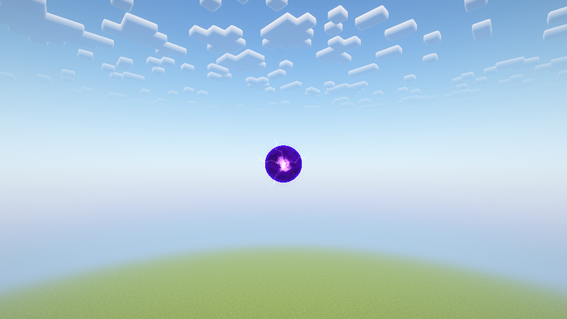
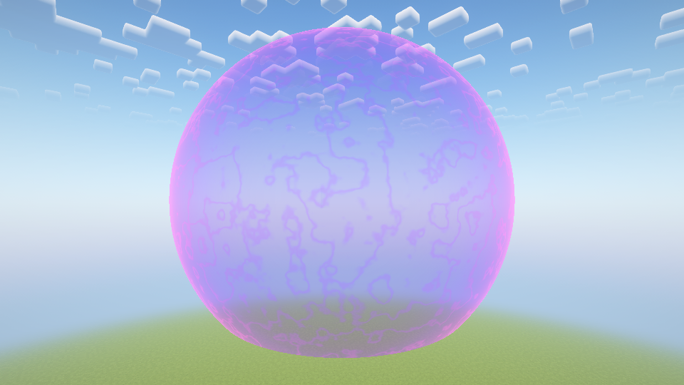

# 1.5.0 空中自爆茈

2026-10-27，Minecraft1.20.1、Forge47.4.20、Java17。使用独立新世界与离线测试身份，不打开原存档。

## 机制与画面

苍和赫在无障碍空中暂留，另一种术式通过服务端扫掠碰撞命中后消耗双方，形成固定在碰撞位置的茈。约44tick膨胀，接着球形冲击波扩散至服务端同步的半径，最后淡出。默认半径64格、中心基础伤害480点、边缘120点，施术者反噬比例0.05。详见[玩法和配置](LIMITLESS.md)。

本页两图为指定光影的实际游戏采集，光晕边缘属于视觉演出。冲击波和伤害前沿由同一套半径、时序函数驱动；截图不代表所有已加载目标都能穿过墙壁受伤。粒子版灶·开仍在独立本地预览分支，没有并入本版。

## 实际运行检查

普通实机组合套件检查苍→赫、赫→苍两种顺序，先发能量球空中暂留、碰撞消耗双方、膨胀、爆炸和超时清理。真实伤害事件确认近目标单次大伤害、55格远目标受伤、半径外目标不受伤、队友保护、实心墙体遮挡，以及普通射距下施术者承受减伤反噬后存活。旁观在膨胀期取消，不触发爆炸。默认地形保持。

双客户端通过127.0.0.1 TCP连接，远端验证两次膨胀、两次爆炸、同步半径和音效去重。第一次握手发生超时，受限重试后建立连接；失败/未完成的首次运行不计为通过。普通运行证据：`build/fuga-combat-network-purple-combo-retry/{host,observer}`。

指定光影组合为Oculus1.8.0、Embeddium0.3.31、Complementary Reimagined5.2.2，运行时确认真实IrisRenderingPipeline。验证自爆茈的球体、膨胀与冲击波，不将其当作所有领域背景兼容证明；御厨子血红天空/镜面的限制仍见[1.4.1记录](SHRINE_SLASH_VALIDATION.md)。

最终网络主机24项、远端3项检查，光影25项检查通过；旧术式普通实机回归37项通过。光影证据为`build/fuga-combat-shader-purple-combo-final/host`，旧术式为`build/fuga-combat-plain-limitless-150-regression/host`，均以各自完成标记结束，无套件失败标记。正式JAR的87个生产类、41项游戏资产与这三份最终实测包逐字节一致；不含测试入口或灶·开粒子试作。26段音频与1.4.1一致。

## 边界和验证范围

新规则检查覆盖快进弹道越过球心、接触半径边界、擦过与零长度扫掠、膨胀单调性、冲击波半径上下限、伤害衰减及无效输入。89项新检查与161项既有规则共250项，均为无窗口检查，不替代实机画面。

同步通道升级为协议2，包中新增爆炸半径。限制状态数量、阶段/术式组合、半径范围、方向长度与有限坐标；客户端与服务端需同版本。客户端不提交命中点、伤害或半径。

每次爆炸最多512个唯一目标，每tick最多检查128个候选；只访问已加载区域。地形仍默认关闭，手动开启时每tick最多检查125个位置、破坏16块，并保留Forge破坏事件、交互权限、液体/基岩/方块实体保护。该模式按预算分散取样，不是完整球体挖空。本轮未进行开启地形破坏的大范围实机压力验证，也未将双客户端测试当作公网延迟、32代理/8术式并发或全部硬件GPU性能保证。

声音复用用户此前选择的茈聚能与命中片段，没有导入新录音。自动融合不重复播放C键直射的整句语音；声音事件检查不能替代人工试听。
