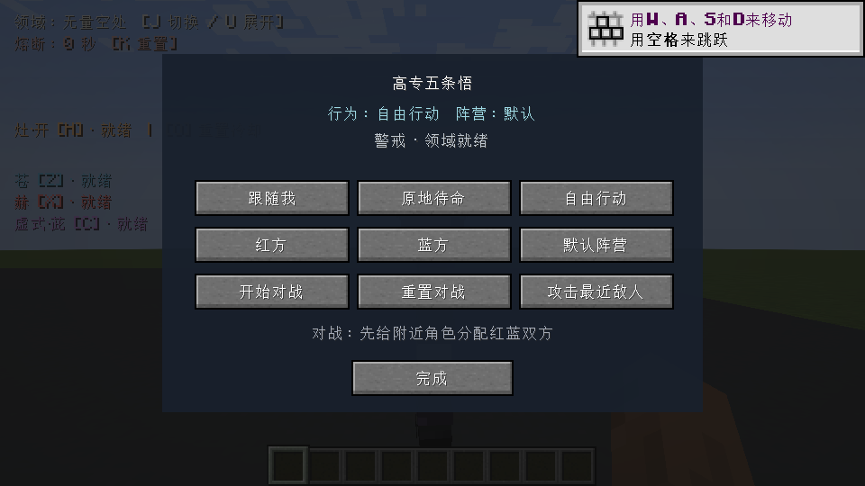
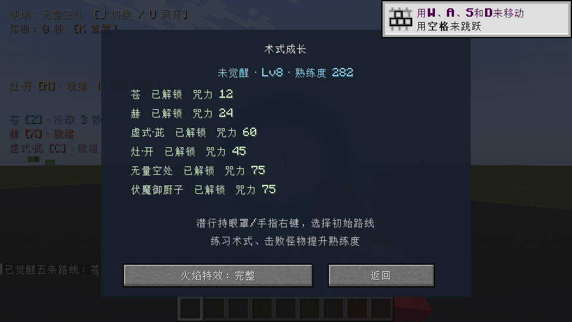

# 1.12.0 顺序实施与验证

五项按顺序接入，并分别完成编译；最后在独立新世界进行整体验证。未进入原存档、未启动或结束原游戏实例。

## 双客户端实机

`tools/run_fuga_qa.py --suite roadmap --mode network --run-id roadmap-stable`，固定QA JAR SHA256 `ce985ac5431a655fea1c718dc2fe42388fe297c246762be1dc9e96eef8ced271`。主客户端集成服务器监听本机回环地址，观察者为独立远程客户端，两个进程都使用相同固定包。

主端 39 次断言、远端 3 次断言通过，均有完成标记且无失败标记。覆盖：

- 前摇侧移实际走动、受伤撤步、硬直破绽追击；地面安全检查和普通寻路。
- 瞄准HUD；真实原生管理界面按钮回调经网络改变待命、跟随、自由行动和阵营；实际跟随位移。
- 红蓝开始对战保存快照，重置恢复原UUID、血量和阵营，并关闭管理页；召唤魔虚罗继承阵营和响应召唤者待命。
- 生存客户端不能用请求绕过锁定技能；真实物品使用选择路线并消耗，苍实际创建术式并准确扣除咒力；赫/茈解锁、空咒力拒绝、创造模式豁免。
- 实际玩家保存NBT含成长数据、死亡Clone继承；P成长页通过网络打开，三档火焰预算循环保存。
- 远端真实连接，属性同步；远端生存权限发送修改请求后，服务端角色状态保持不变。观察者为持续观测被设为免伤，但没有创造能力或管理员权限。

## 持续群战与特效采样

5波、每波16个NPC，约65秒、1300个服务端tick；每波触发玩家灶·开，包含真实火焰特效和伤害。源集成服务端与远程客户端同时运行；远端在该阶段约62秒后退出，主端收尾。采样：

`ticks=1300 meanMs=5.052701076923076 p95Ms=8.639 maxMs=85.5566 frameP95Ms=22.5429`

本机服务端tick平均5.05ms、P95为8.64ms、单次最高85.56ms；主客户端帧间隔P95约22.54ms。期间术式/领域数量及火焰粒子上限检查通过。该统计是当前机器、无光影、固定场景的采样，不代表所有硬件、公共服务器延迟或长时间运行保证。

## 规则、资源与边界

正常生产构建运行原有2257项检查及新增12021项成长边界检查，共14278项。最终生产包核对与安装哈希见下方记录。原始照片不变，没有新增第三方媒体。

早期测试保留：清理了测试世界原版怪物的干扰；修复了测试统计数组跨线程排序的竞态；一次观察者连接超时，最终固定包并采用有限次重连后完成。最终证据以 `build/fuga-combat-network-roadmap-stable/host/console.log` 和 observer 对应日志为准。界面检查使用原生按钮回调和网络请求，没有冒充人工鼠标输入。

未进行公网延迟/丢包模拟、独立专用服务器、其他模组及光影组合验收。本次不推送GitHub。

收尾追加针对性验证：手动跟随/待命解除原拴绳，自动踢击目标筛选尊重手动管理状态，避免抢回控制。该修改只涉及 `NpcControlService` 与 `SunDogPrankGoal` 两个类；其他生产内容与上述固定双客户端测试包逐字节比对。最终包另与 `roadmap-orders` 的13项单客户端生成/显示/指令兼容检查比对。

最终生产构建通过14278项规则检查；237个生产class/asset/data与针对性QA包相同。与综合双客户端固定包的差异仅为上述两个指令/拴绳兼容类，针对性13项检查通过。生产包不含测试类。已安装至指定mods文件夹，旧1.11.0改为disabled备份，仅一个本模组启用。SHA256：`5e205437f38be2e1466f59dc0d5c9ff774c0e48a4bb8dd73748f789296bd3fe6`。
