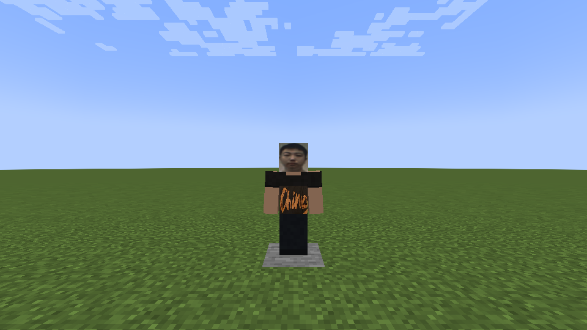

# 孙狗的奴隶 — 本地1.10.8

正脸直接裁自用户右图，上衣正面裁自左图黑色橙字衣服，未展示的裤鞋按黑色处理。1024×1024高清贴图，标准玩家模型；复用和平照片NPC行为，100生命、散步、浮水、看向玩家与持久保存，独立实体ID与生成蛋，不替换无辜的孙狗。

```mcfunction
/give @p unlimitedvoid:sun_dog_servant_spawn_egg
```

- 正常 `cleanCompileJava build`：1671项规则检查通过。
- 独立新世界 `--suite sundogservant --mode plain`：11项实机检查通过，验证真实生成蛋使用、专属创造栏、中文名称、100生命、持久性、NBT往返、客户端同步、渲染器和1024高清资源。
- 实机截图：`build/fuga-combat-plain-sun-dog-servant-1/host/screenshots/sun-dog-servant-ingame.png`，已人工查看。
- 生产JAR不含测试类，197个生产class/asset与实机QA包逐字节一致；原角色贴图与1.10.7保持相同。
- 已安装至用户mods文件夹，旧1.10.7改为disabled备份；仅一个本模组JAR启用。
- SHA256：`7a961e86fd9e7b644129d5195bd627002c83aeb6cd57bbd27d3bb8b6314de62f`。

未修改原存档。未重测远程多人、光影或长期性能。本次尚未同步GitHub。照片不纳入MIT许可；来源说明见THIRD_PARTY_NOTICES.md。

## 同版本本地脸部修订

按用户最新图片替换正脸，裁切像素坐标(203,112)–(610,710)，缩放至128×128后覆盖高清皮肤UV(128,128)–(256,256)。像素差异检查确认只改正脸；衣服、头侧、行为及注册均保持原样。上文11项实机检查对应修订前贴图，本次为资源替换与生产包核对，未重新运行游戏。当前生产包哈希以本节后续安装记录为准。

脸部修订生产包构建通过，打包贴图与源PNG逐字节相同，不含测试类；已覆盖安装并保留旧脸版本disabled备份。新SHA256：`6464fb9af097385ee21b973c2a5f7eab3431c2af86b737f68062c199336d0b8d`。

## 2026-10-31 发布同步

以上记录保留本地实施时的验证边界。现按项目所有者要求汇总随1.11.0发布；Release安装包以SHA256SUMS.txt为准，文中旧哈希为当时本地安装包。实机近战预览与派生照片贴图已同步，未收录整张原始照片。

发布前使用1.11.0相同生产class/asset的独立QA包重新运行 `--suite sundogservant --mode plain --run-id publish-1-11-photo`，11项检查通过，最新脸部的正面实机截图见下方。此前脸部未重跑的表述保留为当时状态。


