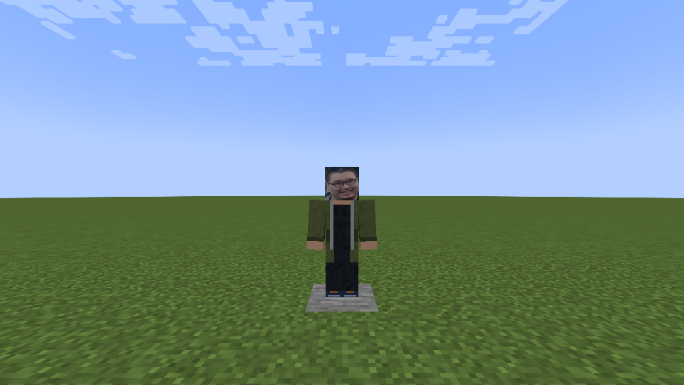

# 无辜的孙狗 — 1.10.7

新增独立和平 NPC `unlimitedvoid:innocent_sun_dog`，100 生命，会浮水、散步和看向玩家，不主动战斗，不自然刷新，持久保存。标准玩家方块模型，使用用户确认的 1024×1024 高清真人脸贴图。

刷怪蛋 `unlimitedvoid:innocent_sun_dog_spawn_egg`，中文显示名为“无辜的孙狗”，添加到模组专属创造栏。命令：

```mcfunction
/give @p unlimitedvoid:innocent_sun_dog_spawn_egg
```

验证：正常 `cleanCompileJava build` 通过全部 1671 条现有检查。独立新世界 `--suite sundog --mode plain` 通过 11 条实机检查，包括真实刷怪蛋使用、专属栏、中文名称、100 生命、持久性、NBT 往返、客户端同步、独立渲染器与高清资源。截图保存在 `build/fuga-combat-plain-sun-dog-1/host/screenshots/sun-dog-ingame.png`。未进入原存档。未进行本角色远程多人或光影验证。

生产 JAR 排除了测试类，195 个生产 class/asset 与实机测试 JAR 逐字节相同。已安装至用户指定的 mods 文件夹，旧 1.10.6 改名 disabled 备份；仅一个启用的本模组 JAR。

本地 JAR SHA256：`bfa18fee08fac6510067b1f5902ed01f4489bc2d305197fa3ee8fcb4e4c256c5`。

按用户要求随1.10.7同步代码、派生贴图与实机截图。照片素材许可说明见 [THIRD_PARTY_NOTICES.md](../THIRD_PARTY_NOTICES.md)。发布包校验以 Release 的 SHA256SUMS.txt 为准；上述哈希为本地安装包。


