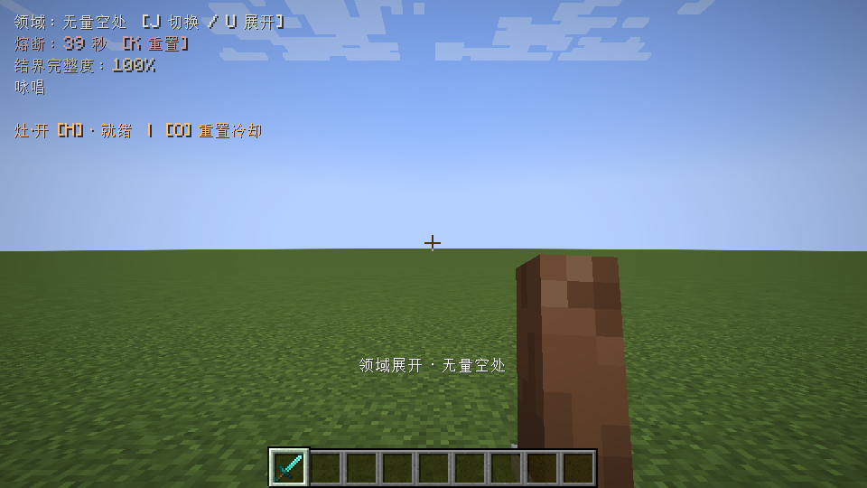
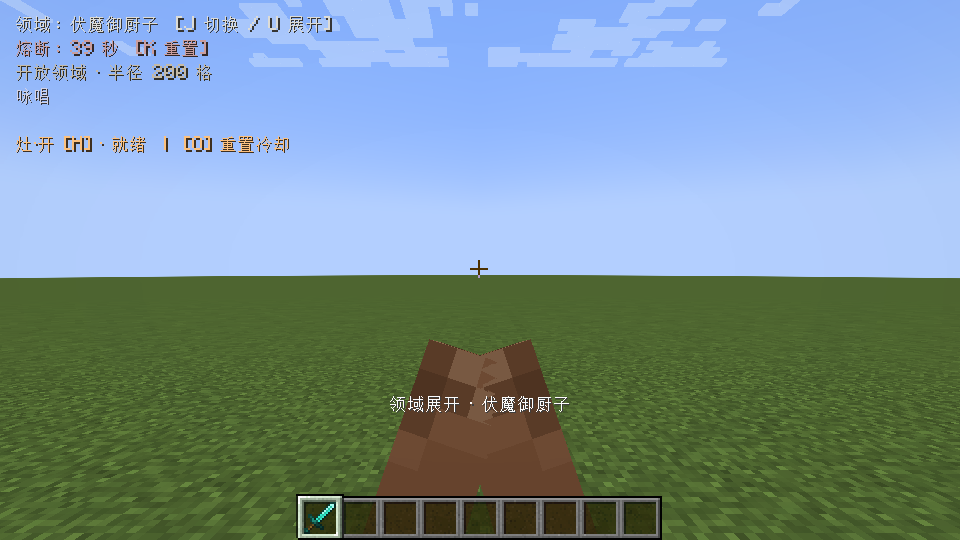
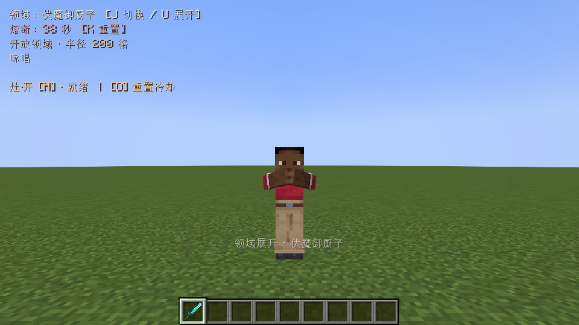

# 1.2.1 原版方块手臂结印

2026-10-27，Minecraft1.20.1、Forge47.4.20、Java17独立新世界实测。删除独立手指网格和第三人称附加手掌层；第一人称调用与灶·开相同的`PlayerRenderer.renderRightHand/renderLeftHand`，第三人称只调整原版手臂姿态。

使用真实U/J/K键切换、展开及取消领域，目视检查两种视角：五条单手抬到脸前，宿傩双手向中间靠拢。咏唱结束或主动取消后恢复持物，钻石剑仍在原位。范围伤害及旧配置迁移回归套件通过，日志结束标记为`DOMAIN_SEAL_TEST_COMPLETE`，证据保留在`build/fuga-combat-plain-block-seals-121-a/host`。

正式构建通过161项无窗口规则检查。此轮实机未开启光影，未重跑双客户端和并发压力套件；旧版验证分别保留，不作为本轮新增结论。

复现：`-PvisualTest=true jar`构建专用测试包，再通过`tools/run_fuga_qa.py --mode plain --suite seals`运行。正常发布包不含测试入口和已删除的手指模型类。
